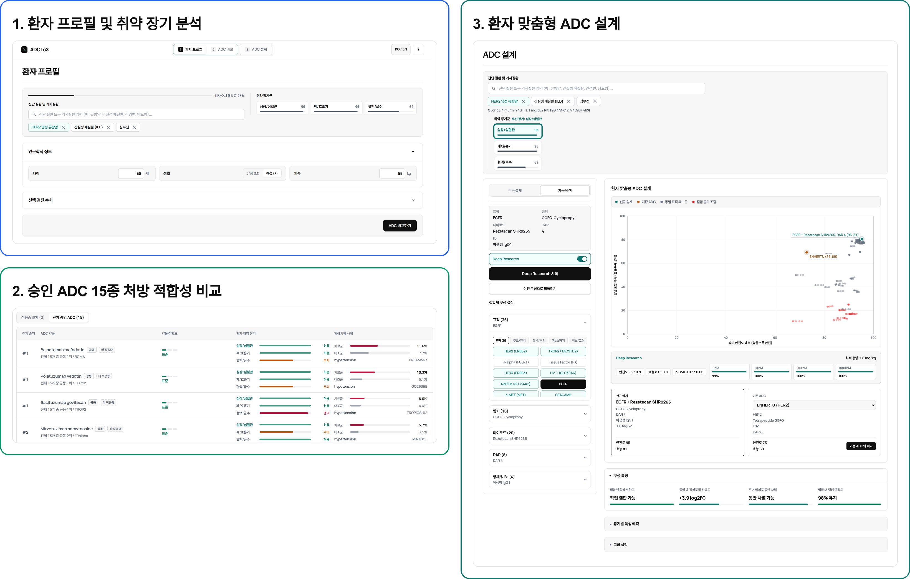
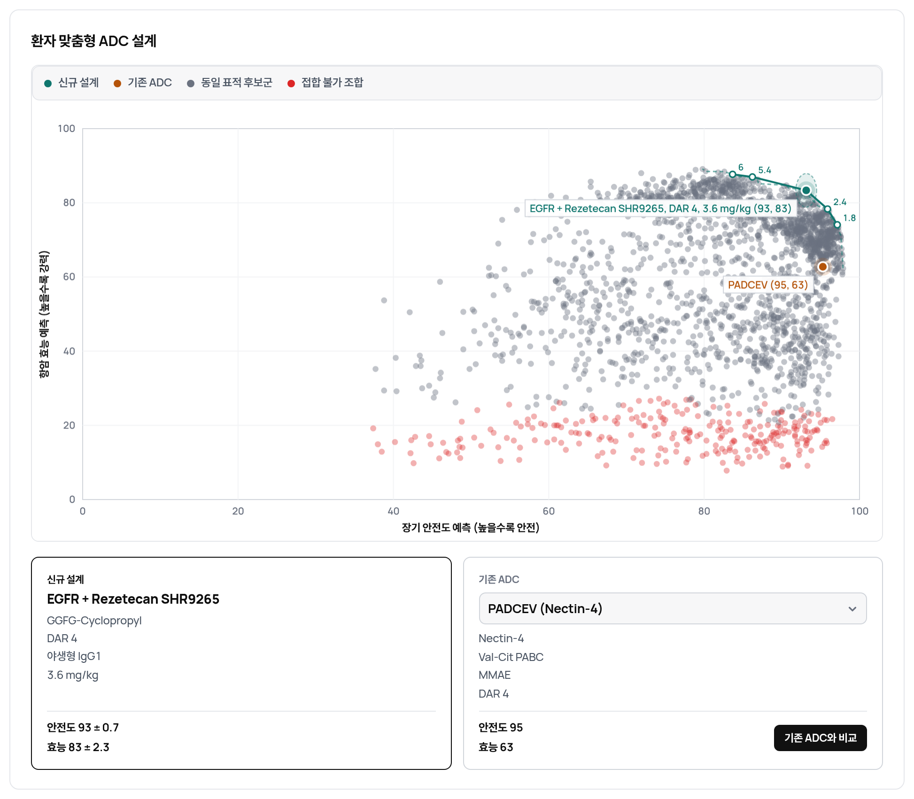

# ADCToX

[](#installation)
[](#installation)
[](#installation)
[](https://github.com/ahnhc/ADCToX/releases/latest)
[](LICENSE)
[](https://adctox.hyeongchan.dpdns.org)

Patient-specific antibody-drug conjugate (ADC) safety evaluation and *de novo* molecular design platform.

ADCToX maps patient malignancies, comorbidities, and clinical biomarkers to 13 organ vulnerability axes (`x2te`, 110M parameters), ranks all 15 FDA-approved ADCs against DailyMed SPL rules and pivotal trial outcomes, and optimizes custom conjugates across 368,640 architectures via 5-fold `ADC-SurrogateNet-v2` and Q3W PK/PD simulation.





## Overview

| Stage | Role | Core Engine & Data |
|---|---|---|
| **Patient Profile** | Maps diseases (`EN / KO`) and lab panels to 13 organ axes | `x2te` (110M LM), MONDO, Cockcroft-Gault / ULN |
| **Recommend ADCs** | Safety-first ranking of 15 FDA-approved ADCs | 120 DailyMed SPL rules (incl. Pediatric §8.4), 32 pivotal trials |
| **ADC Design** | Manual scoring and `Auto Design` across 368,640 constructs | 5-fold `ADC-SurrogateNet-v2`, 252-step Q3W PK/PD ODE, 64-QMC |

## Installation

**Linux (`x86_64` / `arm64`) & macOS (`Apple Silicon`)**

```bash
curl -fsSL https://raw.githubusercontent.com/ahnhc/ADCToX/main/install.sh | bash
```

**Windows 10 / 11 (PowerShell)**

```powershell
irm https://raw.githubusercontent.com/ahnhc/ADCToX/main/install.ps1 | iex
```

Installs an isolated Python runtime, downloads the organ judge model bundle (~305 MB), and registers `adctox` (web workspace) and `adctox-cli` (terminal UI).

## Usage

```bash
adctox                 # Open web workspace in default browser (127.0.0.1)
adctox-cli             # Open terminal UI
adctox --update-app    # Update application to latest release
adctox --update-models # Update model bundle
```

**Server Hosting**

```bash
ADCTOX_NO_BROWSER=1 ADCTOX_AUTO_RESTART=1 ADCTOX_HOST=0.0.0.0 ADCTOX_PORT=8765 ADCTOX_ALLOWED_HOSTS="*" adctox
```

## Documentation & License

- [Algorithm Specification (PDF)](docs/ADCToX_Algorithm_Specification.pdf)
- [Changelog](CHANGELOG.md)
- [Third-Party Notices](THIRD_PARTY_NOTICES.md)

Licensed under the [Apache License 2.0](LICENSE).
