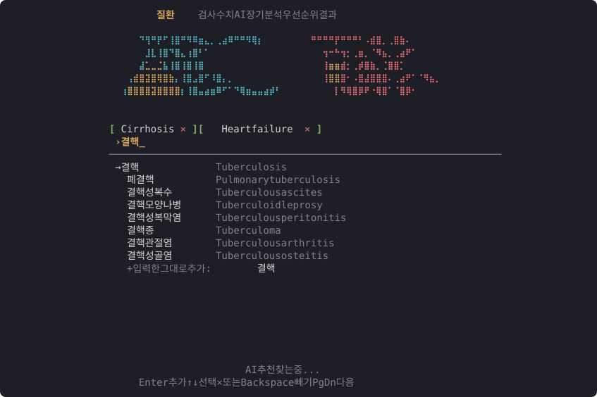
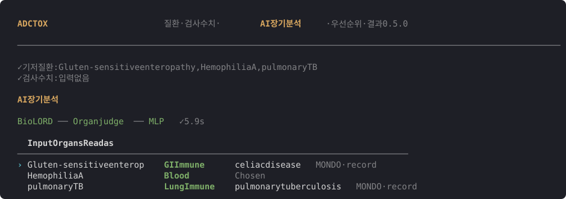
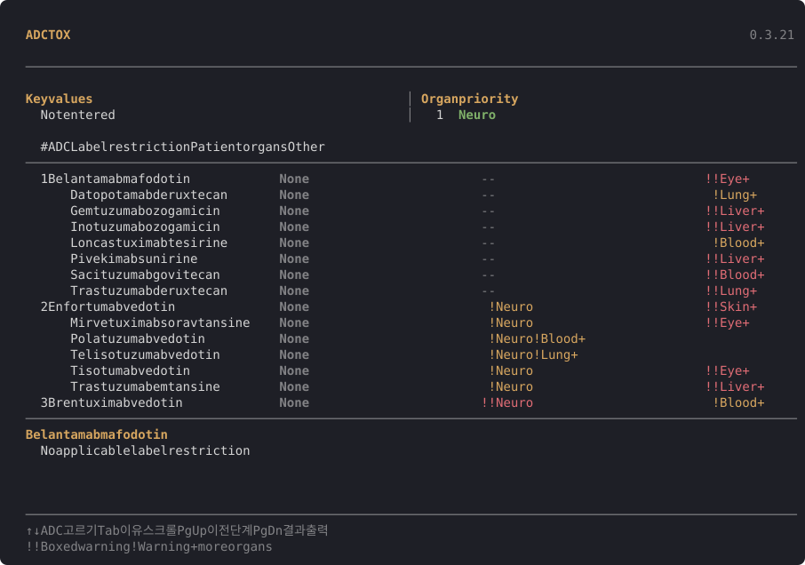

# ADCTOX

[](docs/INSTALL.md)
[](docs/INSTALL.md)
[](docs/INSTALL.md)
[](https://github.com/ahnhc/ADCToX/releases/latest)
[](https://github.com/ahnhc/ADCToX/actions/workflows/terminal.yml)
[](https://github.com/ahnhc/ADCToX/actions/workflows/install.yml)

환자의 기저질환과 검사값을 넣으면, 승인된 ADC 15종을 의약품 라벨 근거로 비교해 주는 터미널 앱입니다.

- **질환 입력:** 한국어, 영어, 약어, 증상 문장으로 찾습니다. MONDO 사람 질환 23,258개에 한국어 이름이 있습니다.
- **AI 장기 분석:** 입력한 질환이 13개 장기 중 어디에 해당하는지, 이 프로젝트에서 처음부터 학습한 판정 모델이 정합니다(앱 0.5, 모델 0.7부터). 모든 계산은 PC 안에서만 합니다.
- **결과:** ADC마다 Label restriction, 환자 장기와 겹치는 경고(Boxed warning, Warning), 확인할 검사값을 보여 줍니다.

연구용 프로토타입입니다. 장기 판정은 독성 발생 확률이 아니고, 임상 판단을 대신하지 않습니다.

<p align="center">
  
</p>

<p align="center">
  
</p>

<p align="center">
  
</p>

## 설치

관리자 권한 없이 한 줄로 설치합니다.

**Linux, macOS (Apple silicon)**

```bash
curl -fsSL https://raw.githubusercontent.com/ahnhc/ADCToX/main/install.sh | bash
```

**Windows 10, 11** (PowerShell)

```powershell
irm https://raw.githubusercontent.com/ahnhc/ADCToX/main/install.ps1 | iex
```

설치가 끝나면 `adctox`를 실행합니다. Windows는 시작 메뉴의 ADCTOX를 눌러도 됩니다.

- Python 3.12가 없으면 설치 폴더 안에 따로 받습니다. 시스템 Python은 바꾸지 않습니다.
- 처음 설치할 때 CPU 추론 환경과 모델 파일(약 1.4 GiB)을 받습니다.
- Intel Mac은 지원하지 않습니다.
- 설치 경로, GPU, 삭제 방법은 [설치 안내](docs/INSTALL.md)에 있습니다.

## 사용법

화면 위의 `질환 · 검사 수치 · AI 장기 분석 · 우선순위 · 결과`가 다섯 단계이고, 현재 단계가 밝게 표시됩니다. 화면 이동은 **PgUp / PgDn**으로만 합니다.

| 단계 | 하는 일 |
|---|---|
| 질환 | 질환명이나 증상을 입력하고 Enter로 추가합니다. Backspace로 마지막 질환을 뺍니다. |
| 검사 수치 | 아는 값만 입력합니다. 비워 두어도 됩니다. |
| AI 장기 분석 | 입력을 어떤 질환으로 읽었는지와 장기를 확인합니다. Read as 끝의 `label`·`record`·`name`은 장기를 정한 근거입니다(장기 라벨표, MONDO 기록 읽기, 입력 이름만 본 판정). |
| 우선순위 | 장기가 다른 질환이 여럿일 때, 어느 질환의 독성을 먼저 피할지 정합니다. 기본은 질환 심각도 순입니다. |
| 결과 | ↑↓로 ADC를 고르면 아래에 이유가 나옵니다. PgDn으로 표를 출력하고 끝냅니다. |

분석 화면의 애니메이션과 표가 나타나는 모션은 `ADC_MOTION=0`으로 끌 수 있습니다.

## 업데이트

```bash
adctox --update-app        # 앱
adctox --check-models      # 새 모델 확인
adctox --update-models     # 모델 업데이트
adctox --rollback-models   # 이전 모델로 되돌리기
adctox --version
adctox --model-version
```

앱과 모델은 버전을 따로 관리합니다. 모델은 바뀐 파일만 받고 SHA256을 확인한 뒤 전환합니다. 변경 내용은 [CHANGELOG](CHANGELOG.md)에 있습니다.

## 모델

| 구성 | 역할 |
|---|---|
| 판정 모델 (BERT-base, 처음부터 학습) | 입력 → MONDO 질환 연결, 유효 입력 판정, 13개 장기. PubMed 초록, UMLS(제한 등급 0), MONDO, HPO 텍스트로 무작위 가중치에서 학습 |
| MONDO 기록 읽기 결과 | 라벨이 없는 MONDO 질환은 정의·상위 개념·증상 기록을 읽은 모델의 장기를 쓴다(미리 계산한 표) |
| BioLORD | 증상 문장 검색 |
| 장기 라벨 | MONDO 사람 질환 21,032개의 13개 장기 라벨, LLM 에이전트가 만들고 검수 |

평가는 학습과 분리한 dev/test로 했습니다. test 영어 장기 macro-F1(처음 보는 질환과 아는 질환의 평균)은 0.723으로, 튜닝한 Gemma 판정 모델 0.711, 튜닝 안 한 Gemma 0.586과 비교했습니다. 자세한 내용은 [연구 흐름 개요](ml/docs/overview.md) 5절과 [처음부터 만든 모델 문서](ml/docs/scratch_model.md)에 있습니다. 모델 0.6까지 쓴 Gemma 판정 모델은 [Gemma 판정 모델 문서](ml/docs/gemma_judge.md)에 있습니다.

연구 전체 흐름(장기 라벨 v4→v5.1, Gemma·encoder 결합, 처음부터 만든 모델)과 현재 결과는 [연구 흐름 개요](ml/docs/overview.md)에 정리했습니다.

이 저장소의 파이프라인과 데이터로 Gemma를 직접 튜닝하고, 튜닝 안 한 Gemma와 같은 문제로 비교할 수 있습니다. 명령 하나로 학습부터 비교 보고서까지 나옵니다: [재현 방법](ml/docs/reproduce.md). 학습마다 쓴 데이터와 점수는 [학습 기록](ml/docs/tuning_log.md)에 남습니다.

## 개발

```bash
git clone https://github.com/ahnhc/ADCToX.git
cd ADCToX
python -m pytest -q
```

- 코드 구성: [ml/README.md](ml/README.md)
- 빌드와 배포: [docs/DISTRIBUTION.md](docs/DISTRIBUTION.md)
- 이전 단계 문서: [docs/archive/](docs/archive/)
- 데이터와 모델의 출처, 이용 조건: [THIRD_PARTY_NOTICES.md](THIRD_PARTY_NOTICES.md)

원본 워크북, 학습 캐시, 모델 가중치는 저장소에 넣지 않습니다. 코드와 이 프로젝트가 만든 데이터는 [Apache License 2.0](LICENSE)입니다. 문제는 [Issues](https://github.com/ahnhc/ADCToX/issues)에 남겨 주세요.
