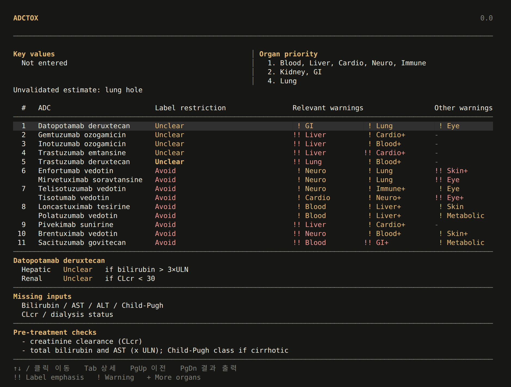

# ADCTOX

[](docs/INSTALL.md)
[](docs/INSTALL.md)
[](docs/INSTALL.md)
[](https://github.com/ahnhc/ADCToX/releases)
[](https://github.com/ahnhc/ADCToX/actions/workflows/terminal.yml)

기저질환과 검사값을 입력하고, AI 장기 분석과 의약품 라벨 근거로 기존 ADC를 비교하는 터미널 애플리케이션입니다.

BioLORD와 SapBERT로 질환을 해석하고, FinnGen 자료로 학습한 MLP ensemble로 장기 취약성을 추정합니다. 결과에서는 환자의 장기 우선순위, 라벨 사용 제한, 관련 경고와 필요한 검사값을 확인할 수 있습니다.

연구용 프로토타입입니다. 장기 추정값은 독성 발생 확률이 아니며, 새로운 ADC 조합의 안전성은 검증되지 않았습니다.

<p align="center">
  
</p>

## Get started

운영체제마다 한 줄로 설치합니다. 관리자 권한은 필요 없습니다.

**Linux, macOS (Apple silicon)** — 터미널에서:

```bash
curl -fsSL https://raw.githubusercontent.com/ahnhc/ADCToX/main/install.sh | bash
```

**Windows 10, 11** — PowerShell에서:

```powershell
irm https://raw.githubusercontent.com/ahnhc/ADCToX/main/install.ps1 | iex
```

설치가 끝나면 `adctox`를 실행합니다. Windows는 시작 메뉴나 바탕화면의 ADCTOX를 눌러도 됩니다.

```bash
adctox
```

- Python 3.12 이상이 없으면 설치기가 Python 3.12를 설치 폴더 안에 따로 받습니다. 시스템 Python은 바꾸지 않습니다.
- 처음 설치할 때 CPU 추론 환경과 모델 파일(약 972 MiB)을 받습니다.
- 질환 분석은 로컬에서 실행됩니다. 인터넷은 설치와 업데이트에만 씁니다.
- Intel Mac은 지원하지 않습니다(PyTorch가 macOS Intel용 빌드를 더 내지 않음).
- `adctox` 명령이 보이지 않으면 설치기가 마지막에 알려 주는 PATH 줄을 추가합니다.
- 설치 경로 변경, GPU 환경, 삭제 방법은 [설치 안내](docs/INSTALL.md)를 참고하세요.

첫 화면에는 질환 목록이 없습니다. 질환명을 입력하면 아래에 바로 추천이 뜨고, 한 글자를 쓰거나 지울 때마다 바뀝니다(한국어, 영어, 약어, 초성, 오타). **TAB**을 누르면 증상이나 문장으로 찾는 메뉴로 바뀝니다(예: `투석 중이고 숨이 차요`).

## Model updates

기저질환 입력 화면에서 **Ctrl+U**를 누르고 **업데이트**를 선택합니다. 터미널 명령으로도 가능합니다.

```bash
adctox --check-models
adctox --update-models
```

앱과 모델은 별도 버전으로 관리합니다. MLP 가중치만 바뀌면 그 파일만 받고, 변하지 않은 BioLORD, SapBERT, MONDO 파일은 재사용합니다. SHA256과 호환성을 확인한 뒤 전체 모델 묶음을 전환하며 이전 모델로 복원할 수 있습니다.

```bash
adctox --version
adctox --model-version
adctox --rollback-models
```

앱 자체는 `adctox --update-app`으로 업데이트하거나 설치 명령을 다시 실행합니다. [변경 기록](CHANGELOG.md)과 [배포 구조](docs/DISTRIBUTION.md)에서 자세한 내용을 확인할 수 있습니다.

## Research

질환의 관련 장기를 찾는 일, 미래 장기 취약성을 추정하는 일, ADC 독성을 예측하는 일을 구분해 평가합니다. 기존 baseline 비교와 성공하지 못한 실험도 함께 공개합니다.

- [현재 구현과 연구 결과](ml/docs/research_status_2026-10-12.md)
- [모델 정확도 개선 및 fine-tuning 계획](ml/docs/model_accuracy_plan_2026-10-12.md)
- [Fable 검토 요청서](ml/docs/fable_review_2026-10-12.md)
- [실험 결과](ml/results/), [기존 구조 모델 카드](docs/MODEL_CARD.md)
- [초기 설계 연구 개요](docs/LEGACY_RESEARCH_OVERVIEW.md)

향후 기존 항체, 링커, payload의 새로운 조합을 탐색하는 단계를 연결할 계획입니다. 현재 배포의 중심은 기존 ADC의 라벨 근거 비교입니다.

## Development

```bash
git clone https://github.com/ahnhc/ADCToX.git
cd ADCToX
```

모델 업데이트와 터미널 테스트, 배포 준비 방법은 [개발 및 배포 안내](docs/DISTRIBUTION.md)에 있습니다. 원본 워크북, 학습 캐시, 모델 가중치는 Git 이력에 넣지 않습니다. 기본 encoder와 MONDO의 출처 및 조건은 [Third-party notices](THIRD_PARTY_NOTICES.md)에 정리했습니다.

문제는 [GitHub Issues](https://github.com/ahnhc/ADCToX/issues)에 남겨주세요.
