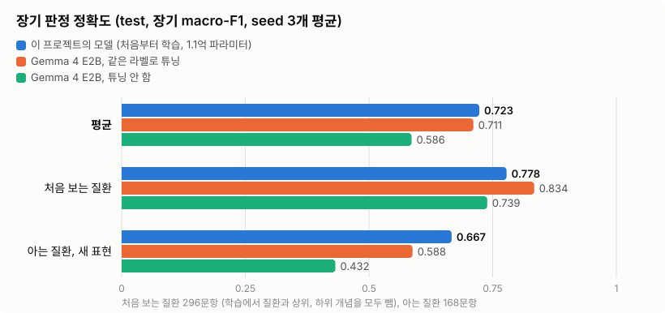
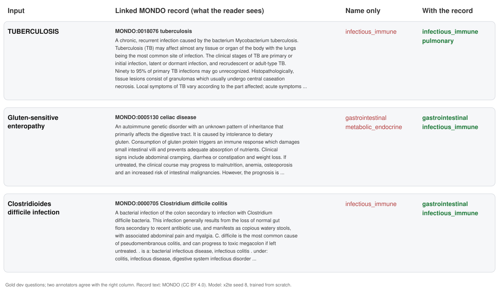

# ADCTOX

[](docs/INSTALL.md)
[](docs/INSTALL.md)
[](docs/INSTALL.md)
[](https://github.com/ahnhc/ADCToX/actions/workflows/terminal.yml)
[](https://github.com/ahnhc/ADCToX/actions/workflows/install.yml)

**환자의 기저질환 이름만으로 이미 손상된 장기를 판정하고, 환자의 암에 승인된 ADC 중 그 장기에 라벨 경고가 적은 약부터 보여 주는 터미널 앱입니다.** 장기 판정은 공개 의학 텍스트만으로 처음부터 학습한 1.1억 파라미터 모델이 PC 안에서 합니다.

<p align="center">
  
</p>

## 왜 필요한가

ADC(antibody-drug conjugate)는 항체에 강한 세포독성 payload를 붙인 항암제입니다. payload와 linker에 따라 손상되는 장기가 다릅니다. DXd 계열은 간질성 폐질환, MMAE 계열은 말초신경병증, calicheamicin과 DM1 계열은 간 독성이 대표적입니다. 그래서 15종의 FDA 라벨에는 장기별 Boxed warning과 Warning이 촘촘하게 걸려 있습니다.

흔한 기저질환 하나만 있어도, 그 장기에 경고가 걸린 ADC가 15종 중 절반 가까이 됩니다.

| 기저질환 | 손상된 장기 | 그 장기에 경고가 있는 ADC |
|---|---|---|
| Interstitial lung disease, COPD | Lung | **8 / 15** |
| Cirrhosis | Liver | **7 / 15** |
| Heart failure, hypertension | Cardio | **7 / 15** |
| Peripheral neuropathy | Neuro | **7 / 15** |
| Glaucoma | Eye | **6 / 15** |
| Type 2 diabetes | Metabolic | **4 / 15** |

기저질환이 있는 환자는 임상시험에서 대부분 제외됩니다. 그래서 라벨에는 해당 환자군이 연구되지 않았다고만 적혀 있는 경우가 많습니다. 결국 의사가 환자마다 15종의 라벨을 기저질환 하나하나와 직접 대조해야 합니다. 게다가 기저질환은 차트에 한국어, 약어, 오타, 증상 문장 등 여러 형태로 적혀 있습니다.

## 목표

1. 어떤 형태로 적힌 기저질환이든 표준 질환(MONDO)에 연결하고, 13개 장기 중 이미 손상된 장기를 판정한다.
2. 그 장기를 ADC 15종의 라벨 경고, 라벨 제한 기준(간, 신장 기능 수치), payload 기전과 맞춰, 환자의 암에 승인된 약부터 경고가 적은 순서로 보여 준다.
3. 거대 언어 모델 없이, 공개 의학 텍스트만으로 처음부터 학습한 작은 모델로 같은 수준에 도달한다.
4. 환자 정보가 PC 밖으로 나가지 않는다.

## 노벨티

**1. 처음부터 학습한 의학 언어 모델.** 사전학습된 가중치를 쓰지 않았습니다. BERT-base 구조를 무작위 가중치에서 시작하고 tokenizer도 직접 만들었습니다. 사전학습 텍스트는 PubMed 초록(86%), UMLS 이름과 정의(12%), MONDO와 HPO(1%)뿐입니다. GPU 1장으로 48시간 학습한 1.1억 파라미터 모델이, 같은 라벨로 튜닝한 Gemma 4 E2B와 같은 수준의 장기 판정 정확도를 냅니다.

**2. 처음 보는 질환은 온톨로지 기록을 읽고 판정한다.** 모델은 입력을 MONDO 질환에 연결한 다음, 그 질환의 정의, 상위 개념, 증상 기록을 두 번째 모델이 읽어 장기를 정합니다. 사람이 모르는 병을 교과서에서 찾아 읽는 방식과 같습니다. 예를 들어 "TUBERCULOSIS"는 이름만 보면 감염으로만 판정되지만, 기록("the lungs being the most common site")을 읽으면 폐와 감염으로 판정됩니다. 이 방식과 오타, 약어 학습을 더하면 처음 보는 질환의 정확도가 0.694에서 0.778로 오릅니다(test).

<p align="center">
  
</p>

**3. 2만 2천여 질환의 장기 라벨.** MONDO 사람 질환 22,638개에 13개 장기 라벨을 만들었습니다. 모든 질환을 독립적으로 세 번 라벨링했고(패스 간 κ 0.94~0.98), 세 번이 다르면 판정하고 일부는 감사했습니다. 이어서 규칙에 따라 다시 검토했습니다. 이 라벨이 판정 모델의 학습 목표입니다.

**4. 라벨 원문 그대로의 판정.** 장기 경고는 DailyMed 라벨의 Boxed warning과 Warnings and Precautions 절에서, 기전은 12.1절 원문에서 가져옵니다. bilirubin ×ULN과 Cockcroft–Gault CLcr은 반올림 없이 라벨 기준값과 정확히 비교합니다.

## 성능

| test, 장기 macro-F1 (seed 3개 평균) | 처음 보는 질환 | 아는 질환, 새 표현 | 평균 |
|---|---|---|---|
| Gemma 4 E2B, 튜닝 안 함 | 0.739 | 0.432 | 0.586 |
| Gemma 4 E2B, 같은 라벨로 튜닝 | 0.834 | 0.588 | 0.711 |
| **이 프로젝트의 모델 (앱에 들어간 모델)** | 0.778 | **0.667** | **0.723** |
| 이 프로젝트의 모델 + Gemma | **0.836** | **0.674** | **0.755** |

- **처음 보는 질환 (296문항):** 흔한 기저질환 211개에 대해 두 사람이 합의한 장기 정답입니다. 이 질환들과 그 상위, 하위 개념은 학습 데이터에서 모두 뺐습니다.
- **아는 질환, 새 표현 (168문항):** 학습한 질환을 논문 속 다른 표현으로 묻습니다.
- 모델 선택은 dev로만 했고, test는 모델을 정한 뒤 채점했습니다.
- 이 프로젝트의 모델은 아는 질환에서, Gemma는 처음 보는 질환에서 강합니다. 둘을 합치면 두 쪽 모두 가장 높습니다.

## 구현된 것

```
기저질환 입력 ──▶ MONDO 질환 연결 ──▶ 13개 장기 판정 ──▶ ADC 15종 라벨 비교 ──▶ 경고가 적은 순서
(한국어, 영어,      (이름 벡터 검색)     (이름 판정, 또는      (Boxed warning, Warning,
 약어, 증상 문장)                        기록 읽기 판정)       라벨 제한, payload 기전)
```

**질환 입력.** 한국어, 영어, 약어, 증상 문장으로 찾습니다. MONDO 사람 질환 23,258개에 한국어 이름이 있습니다. 증상 문장 검색에는 공개 의학 임베딩 모델 BioLORD를 씁니다.

<p align="center">
  
</p>

**AI 장기 분석.** 질환마다 판정 모델의 장기 확률 상위 3개가 나옵니다.

<p align="center">
  
</p>

**ADC 비교.** 암종을 고르면 그 암에 승인된 ADC가 먼저 나오고, 나머지는 그 아래에 이어집니다. 각 묶음 안에서는 라벨 제한과 환자 장기에 걸린 경고 순으로 정렬합니다. 가장 걱정되는 질환을 하나 고르면 그 장기에 경고가 있는 ADC가 아래로 내려갑니다. ADC를 고르면 적응증, 라벨 제한 기준, 환자 장기에 걸린 경고와 절 번호, payload와 linker 기전이 나옵니다.

<p align="center">
  
</p>

**검사 수치.** bilirubin, AST, ALT는 ULN 배수로, 크레아티닌은 Cockcroft–Gault CLcr로 바꿔 라벨의 간, 신장 기능 기준과 맞춥니다. 입력하지 않은 값에 따라 판정이 달라지면 `?`로 표시하고, 필요한 값을 알려 줍니다.

**PC 안에서 실행.** Windows, macOS, Linux에서 관리자 권한 없이 설치되고, 판정은 인터넷 없이 CPU에서 합니다.

## 설치

**Linux, macOS (Apple silicon)**

```bash
curl -fsSL https://raw.githubusercontent.com/ahnhc/ADCToX/main/install.sh | bash
```

**Windows 10, 11** (PowerShell)

```powershell
irm https://raw.githubusercontent.com/ahnhc/ADCToX/main/install.ps1 | iex
```

설치가 끝나면 `adctox`를 실행합니다. 처음 설치할 때 추론 환경과 모델 파일(약 1.4 GiB)을 받습니다. 설치 경로, GPU, 삭제 방법은 [설치 안내](docs/INSTALL.md)에 있습니다.

## 사용법

`암종   질환   검사 수치   AI 장기 분석   우선순위   결과`의 여섯 화면을 **PgUp / PgDn**으로 오갑니다.

| 화면 | 하는 일 |
|---|---|
| 암종 | 환자의 암을 고릅니다. 모르면 15종을 모두 비교합니다 |
| 질환 | 질환명이나 증상을 입력하고 Enter로 추가합니다 |
| 검사 수치 | 아는 값만 입력합니다 |
| AI 장기 분석 | 질환마다 판정한 장기를 확인합니다 |
| 우선순위 | 장기가 다른 질환이 여럿이면, 가장 걱정되는 질환을 하나 고릅니다 |
| 결과 | ↑↓로 ADC를 골라 근거를 봅니다 |

```bash
adctox --update-app      # 앱 업데이트
adctox --update-models   # 모델 업데이트
```

## 더 보기

- [처음부터 만든 모델](ml/docs/scratch_model.md)
- [재현 방법](ml/docs/reproduce.md): 학습부터 비교 보고서까지 명령 하나로
- [코드 구성](ml/README.md)
- [데이터와 모델의 출처, 이용 조건](THIRD_PARTY_NOTICES.md)

코드와 이 프로젝트가 만든 데이터는 [Apache License 2.0](LICENSE)입니다.
