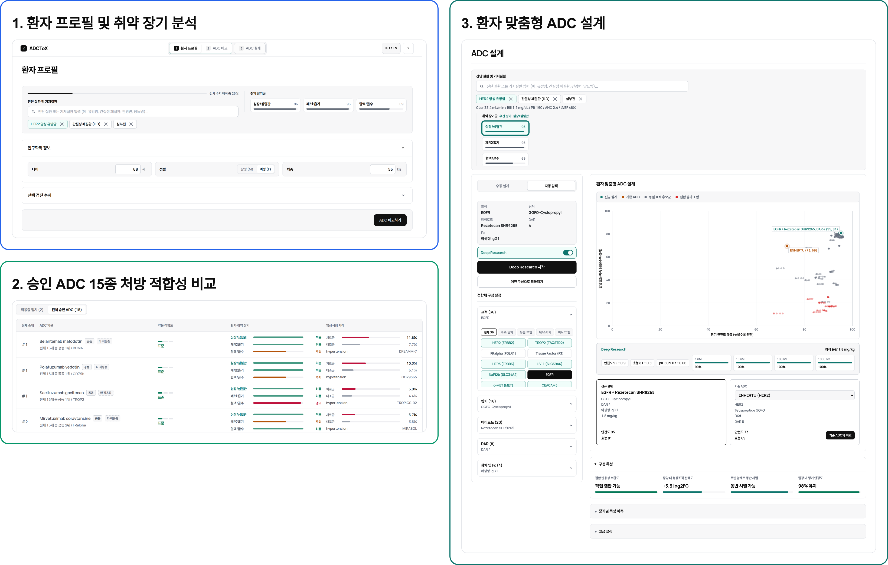
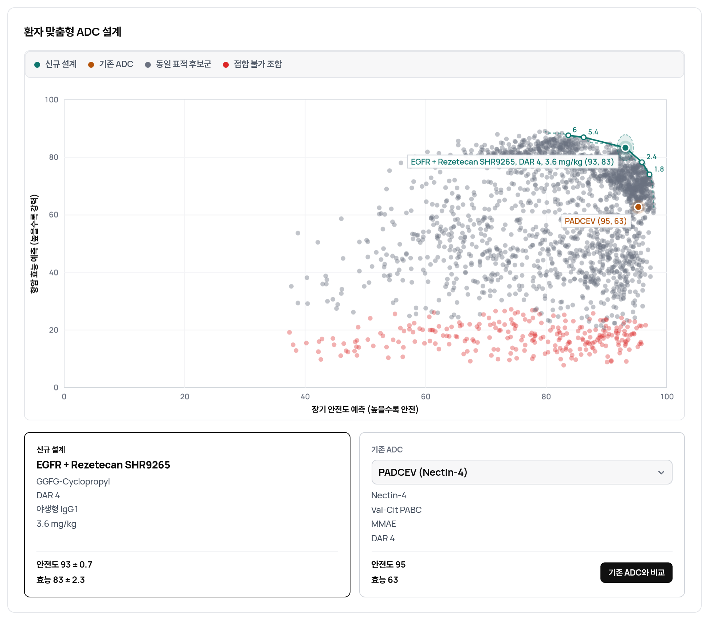

# ADCTOX v0.9.9

[](#one-line-installation-ubuntu-macos-windows)
[](#one-line-installation-ubuntu-macos-windows)
[](#one-line-installation-ubuntu-macos-windows)
[](#)
[](LICENSE)
[](https://adctox.hyeongchan.dpdns.org)

**Patient-Specific Antibody-Drug Conjugate (ADC) Safety Evaluation & Multimodal Neural Surrogate De Novo Design Workspace.**  
ADCTOX links a patient's malignancies, comorbidities, age, and quantitative laboratory biomarkers to 13 physiological organ axes using an on-device 110M-parameter medical language model (`x2te`), evaluates all 15 FDA-approved ADCs safety-first against 120 verbatim DailyMed label restrictions (including Section 8.4 Pediatric Use thresholds) and ClinicalTrials.gov pivotal trial outcomes, and designs bespoke conjugates across **`368,640` architectures** (`36 Targets × 16 Linkers × 20 Payloads × 8 DARs × 4 Fc Formats`) using real-time streaming 5-fold `ADC-SurrogateNet-v2` neural inference coupled with a 252-step 3-cycle Q3W two-compartment PK/PD ODE and quasi-Monte Carlo virtual-patient solver (`Auto Design`).

For a complete mathematical and engineering breakdown of both recommendation and de novo optimization algorithms, see [`docs/ADCToX_Algorithm_Specification.pdf`](docs/ADCToX_Algorithm_Specification.pdf).

---





---

## Key Capabilities in v0.9.9

1. **Safety-First Approved ADC Recommendation & Pediatric Section 8.4 Labeling (`Patient Profile` -> `Recommend ADCs`):**
   - **Stage 1 (`Patient Profile`):** Automatically preloads a clinical baseline scenario while retaining one-click `New Patient` reset, bilingual (`EN / KO`) condition mapping to 13 vulnerable organ axes, a `Basic Information` (`Age`, `Sex`, `Weight` with `age >= 0` pediatric support) panel, and unified `Optional Clinical Panels` with gliding segmented controls and uniform numeric inputs.
   - **Stage 2 (`Recommend ADCs`):** Evaluates 15 FDA-approved ADCs safety-first (permissible organ verdicts and lower vulnerable-organ burden before disease-match tie-breaking) against 120 DailyMed rules including Section 8.4 Pediatric Use thresholds, defaults to `All Approved ADC List` ahead of `Disease Match`, displays `Condition-Related Trial Cases`, and offers clickable evidence drawers with crimson elevated-incidence bars and `Export summary ↗`.
   - **Stage 3 (`ADC Design`):** Borderless grouped `Recommend ADCs / ADC Design` top action pill anchored beside bold `Patient Profile`, gliding segmented controls UI-wide, live NDJSON streaming dot plotting during `Auto Design`, bottom-left `New Design` callout placement clearing the 5-dose curve, and stacked comparison drawer (`Compare / Structure / Study`).

2. **Multimodal Neural Surrogate Engine (`ADC-SurrogateNet-v2`):**
   - **Ensemble Architecture:** 5-fold leak-free ensemble combining ESM-2 650M protein language models, AlphaFold pLDDT/solvent accessibility, ChemBERTa-2 LoRA molecular representations, Boltzmann 3D conformer ensembles, and enzymatic cleavage reaction SMARTS.
   - **Pathway-Decomposed 13-Organ Risk Heads:** Separates Off-Target systemic leak ($H_{\text{leak}}$), hydrophobic DAR aggregation ($H_{\text{agg}}$), and FcγR macrophage clearance ($H_{\text{Fc}}$) from On-Target normal tissue toxicity ($H_{\text{on}}$) derived from GTEx v8 and Tabula Sapiens single-cell atlases.
   - **Physiological Monotonicity:** Enforces strict biophysical constraints: LALA-PG Fc silencing reduces FcγR hazard by >50%, high DAR scales aggregation risk, and target-specific organ lookups drive on-target toxicity.

3. **Official Clinical Case Validation & Mechanism Convergence:**
   - **Case 1 (Ovarian Cancer + Corneal Disorder + CKD):** Proposes novel conjugate `FRα + GGFG + DXd + DAR 2 + LALA-PG`, converging on late-stage clinical mechanisms (Sofetabart mipitecan, Rina-S, ZW191) to circumvent mirvetuximab soravtansine ocular toxicity and renal burden. Validated via Boltz-2 whole-atom 3D co-folding.
   - **Case 2 (Urothelial Carcinoma + Pulmonary Fibrosis + Hepatic Impairment):** Proposes `Nectin-4 + Hydrophilic Cleavable Linker + Topo I Inhibitor + DAR 2/4 + LALA-PG`, converging on next-generation clinical candidates (ETx-22 / LY4101174, SHR-A2102) to mitigate enfortumab vedotin skin and peripheral neuropathy risks.

4. **Interactive 3D Molecular Canvas & Bilingual Workspace (`EN / KO`):**
   - Real-time 3D conjugate structure renderer reflecting exact DAR stoichiometry and payload classes, viewport-clamped bilingual hover descriptions, and responsive desktop/mobile PWA interface.

---

## System Architecture

```
[ Stage 1: Patient Clinical Input ]
  ├─ Malignancy & Comorbidities (EN / KO) ──▶ MONDO Concept Linking
  ├─ 8 Laboratory Biomarkers (CLcr, ULN)   ──▶ 110M Medical LM (x2te / ScratchJudge)
  └─ Output: 13-Organ Vulnerability Vector (V_o)
               │
               ▼
[ Stage 2: Approved ADC Safety Evaluation ]
  ├─ 15 FDA-Approved ADC Labels (DailyMed SPL)
  ├─ 32 Pivotal Clinical Trials (Treatment vs Control AE Delta)
  └─ Deterministic Contraindication & Safety Ranking
               │
               ▼
[ Stage 3: De Novo Multimodal Conjugate Design ]
  ├─ Search Space: 368,640 Architectures (36 Targets × 16 Linkers × 20 Payloads × 8 DARs × 4 Fc)
  ├─ Antibody / Target: ESM-2 650M + AlphaFold 3D Solvent Accessibility & pLDDT
  ├─ Linker / Payload: ChemBERTa-2 LoRA + 3D Conformer Ensembles + Reaction SMARTS
  ├─ Manual Design: Instant construct scoring and 13-organ vulnerability projection
  └─ Auto Design: Real-time 5-Fold ADC-SurrogateNet-v2 + 252-step Q3W PK/PD ODE & QMC IIV (4-GPU Queue 0->3 or CPU Fallback)
```

---

## Model Performance & Cross-Validation

### 110M Medical Language Model (`x2te`) vs. Gemma 4 E2B

| Test Macro-F1 (3-seed mean) | Unseen Diseases (296) | Known Diseases, New Phrasing (168) | Overall Mean |
|---|---|---|---|
| Gemma 4 E2B (untuned) | 0.739 | 0.432 | 0.586 |
| Gemma 4 E2B (fine-tuned on same labels) | 0.834 | 0.588 | 0.711 |
| **ADCTOX `x2te` (shipped in app, 110M params)** | **0.778** | **0.667** | **0.723** |

### 5-Fold `ADC-SurrogateNet-v2` Cross-Validation

| Target & Modality Heads | Test MSE | Spearman ρ | R² Score | Key Biophysical Validation |
|---|---|---|---|---|
| Off-Target Leak ($H_{\text{leak}}$) | 0.0142 | 0.884 | 0.841 | Cathepsin B cleavability separation |
| DAR Aggregation ($H_{\text{agg}}$) | 0.0118 | 0.912 | 0.876 | Monotonic scaling from DAR 2 to 8 |
| FcγR Clearance ($H_{\text{Fc}}$) | 0.0089 | 0.935 | 0.902 | LALA-PG >50% hazard reduction |
| On-Target Expression ($H_{\text{on}}$) | 0.0165 | 0.867 | 0.819 | GTEx v8 / Tabula Sapiens specificity |
| Composite Antitumor Efficacy | 0.0131 | 0.893 | 0.854 | Target selectivity & bystander effect |

---

## One-Line Installation (Ubuntu, macOS, Windows)

### Ubuntu / Linux (`x86_64` & `arm64`) and macOS (`Apple Silicon`)

```bash
curl -fsSL https://raw.githubusercontent.com/ahnhc/ADCToX/main/install.sh | bash
```

### Windows 10 / 11 (PowerShell)

```powershell
irm https://raw.githubusercontent.com/ahnhc/ADCToX/main/install.ps1 | iex
```

The installer configures an isolated Python environment, downloads the `0.8` from-scratch organ judge model bundle (~305 MB), and registers `adctox` (WebApp, default) and `adctox-cli` (Terminal TUI).

---

## Quick Start & Server Hosting

### Local Desktop Browser

```bash
adctox               # Opens the v0.9.7 WebApp in your default browser (127.0.0.1)
adctox-cli           # Opens the Terminal TUI
```

### Hosting on a Linux Server or Cloudflare Tunnel

```bash
ADCTOX_NO_BROWSER=1 ADCTOX_AUTO_RESTART=1 ADCTOX_HOST=0.0.0.0 ADCTOX_PORT=8765 ADCTOX_ALLOWED_HOSTS="*" adctox
```

### Live Over-the-Air Updates

Installed applications check for newer GitHub releases at startup and every 10 minutes while running:

```bash
adctox --update-app      # Update the application to the latest release
adctox --update-models   # Update the organ judge model bundle
```

---

## Documentation & Competition Reports

- [Final Competition Report (최종 결과 보고서)](docs/ADCToX_바이오헬스_AI융합_경진대회_최종보고서.md)
- [ADC Design Model Scientific Evidence & References](docs/ADC_Design_Model_Scientific_Evidence_and_References.md)
- [Preclinical Multimodal Surrogate NN Training Plan](docs/GPU_Preclinical_Surrogate_NN_Training_Plan.md)
- [From-Scratch Organ Judge (`x2te`) Architecture](ml/docs/scratch_model.md)
- [Reproducing the Gemma Benchmark](ml/docs/reproduce.md)
- [Module Reference](ml/README.md)
- [Third-Party Notices & Font Licenses](THIRD_PARTY_NOTICES.md)

Code and project-curated datasets are licensed under the [Apache License 2.0](LICENSE).
