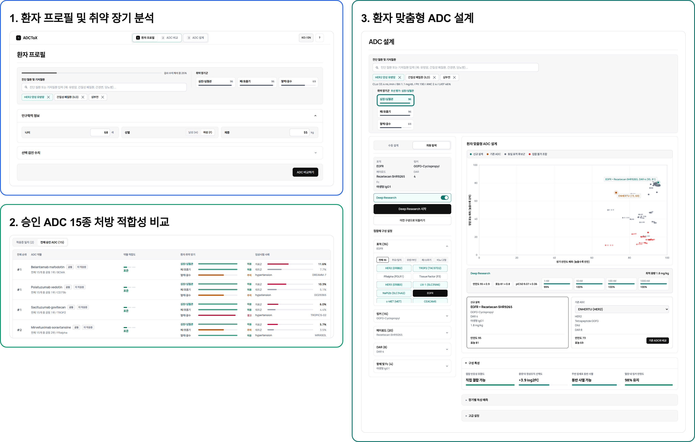
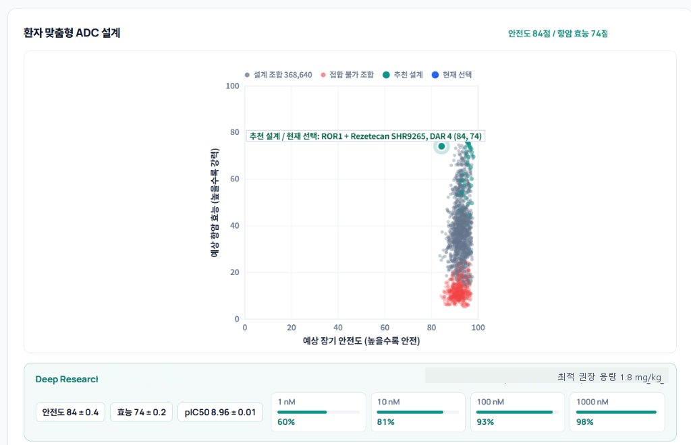
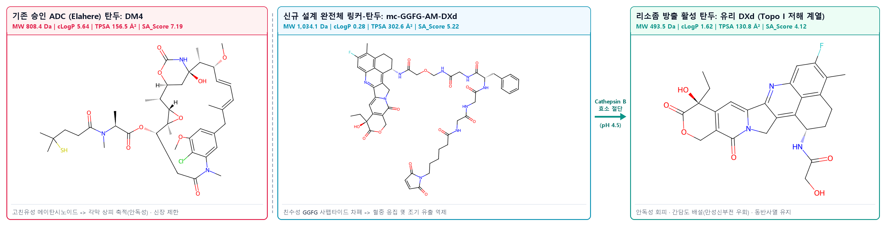
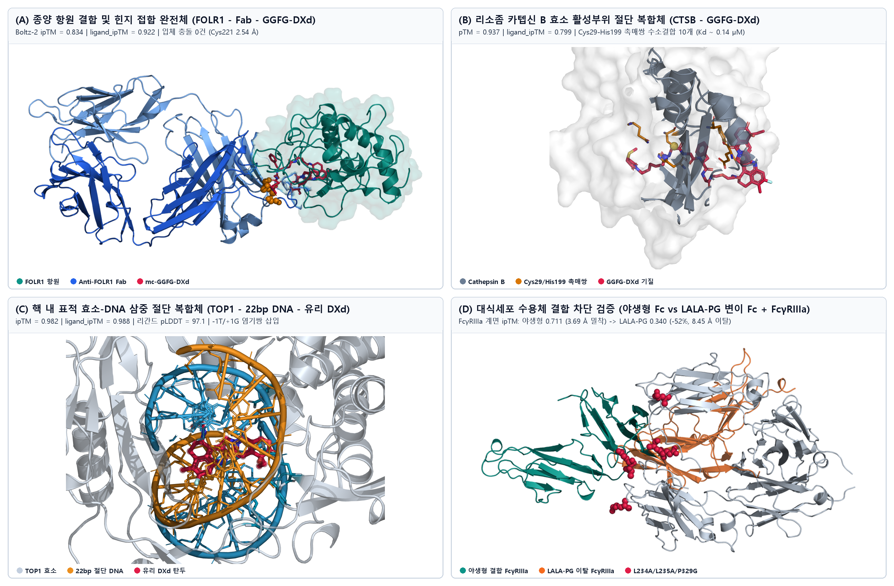

# 바이오헬스 X AI융합 경진대회 최종 결과 보고서

| 항목 | 내용 |
| :--- | :--- |
| **타이틀** | **환자 맞춤형 ADC 안전성 평가 및 신규 분자 설계 플랫폼 ADCToX** |
| **서브 타이틀** | 자체 학습 의학 언어모델과 멀티모달 생체분자 예측 신경망의 결합 |
| **팀 명** | **김치와 버거들** |
| **팀원 구성** | 신중우 / 202221350 / 생명공학과 노희건 / 학번 / 생명공학과 황지원 / 학번 / 생명공학과 안형찬 / 학번 / 바이오메디컬소프트웨어학과 |
| **배포 URL** | `https://adctox.hyeongchan.dpdns.org` |
| **GitHub 저장소** | `https://github.com/ahnhc/ADCToX` |

---

## 목차

- **Ⅰ. 서론**
- **Ⅱ. 본론**
  - 1. 환자 맞춤형 ADC 선정 및 설계 플랫폼 ADCToX
    - 1.1 3단계 임상 의사결정 지원 워크플로우 제안
    - 1.2 임상·생체분자 데이터 수집 및 영역 분리형 설계 과정
  - 2. 환자 장기 취약성 판정 언어모델 개발 및 검증
    - 2.1 병원 내부망 구동을 위한 자체 의학 언어모델 설계
    - 2.2 동결 평가셋 성능 검증 및 거대언어모델 비교
  - 3. 생체분자 상호작용 반영 신규 ADC 설계 및 구조 검증
    - 3.1 다중 모달리티 기반 구조-독성 예측 신경망 구축
    - 3.2 복합 기저질환 환자 사례 적용 및 화학 구조·3D 접힘 검증
    - 3.3 차세대 임상 후보군과의 작용기전 수렴성 및 한계 고찰
- **Ⅲ. 결론**
- **Ⅳ. 참고문헌**

---

## Ⅰ. 서론

항체-약물 접합체(Antibody-Drug Conjugate, 이하 ADC)는 암세포 표면 항원을 표적하는 항체에 강력한 세포독성 약물(payload)을 화학 링커(linker)로 연결한 정밀 항암제입니다. 현재 미국 식품의약국(FDA)이 승인한 15종의 ADC가 유방암, 난소암, 요로상피암 등 다양한 난치성 암종에서 표준 치료제로 사용되고 있으나, 실제 임상 현장에서는 중증 장기 독성으로 인해 용량을 감량하거나 투여를 중단하는 사례가 빈번합니다[1]. 혈중 순환 중 링커가 조기에 절단되어 유리 독소가 유출되거나, 소수성 약물이 결합한 항체가 간·각막 세포에 비특이적으로 축적되고, 면역세포의 FcγR 수용체가 항체를 흡수하면서 간질성 폐질환, 각막병증, 말초신경병증, 골수억제 등이 나타나기 때문입니다.

그럼에도 허가 라벨의 경고문과 임상시험 이상반응 통계, 신장·간 기능별 용량 기준이 여러 문서에 흩어져 있어 의료진이 환자 1명의 처방 적합성을 검토하는 데 상당한 시간이 소요됩니다. 특히 각막 질환과 만성신부전이 함께 동반된 난소암 환자처럼 복합 기저질환을 가진 경우에는 기존 승인 약물이 모두 경고나 코호트 제한에 걸려 마땅한 처방 대안을 찾기 어렵습니다. 저희는 이러한 임상 현장의 병목을 해결하기 위해, 환자별 승인 ADC 안전성 선별부터 고위험 환자 맞춤형 신규 ADC 분자 설계까지 지원하는 웹 플랫폼 **ADCToX**를 개발하였습니다.

---

## Ⅱ. 본론

### 1. 환자 맞춤형 ADC 선정 및 설계 플랫폼 ADCToX

#### 1.1 3단계 임상 의사결정 지원 워크플로우 제안
저희는 환자의 기저 질환, 혈액 및 장기 기능 검사 수치, 약물 투약 이력을 종합하여 ADC의 장기별 부작용 위험을 산출하고 처방 및 설계 대안을 제시하는 플랫폼인 **ADCToX**를 제안합니다. 별도의 프로그램 설치 없이 웹 브라우저에서 바로 실행할 수 있으며, 실제 진료 현장에서 의료진의 의사결정 순서에 맞추어 3단계의 탭으로 구성되어 있습니다(그림 1).

- **첫째, `[환자 정보]` 탭**에서 환자의 암종, 기저 질환, 혈액·생화학 검진 수치(빌리루빈, 크레아티닌, 혈색소, 좌심실 구혈률 등)를 입력하면 13개 인체 장기별 손상 취약도가 자동으로 산출됩니다.
- **둘째, `[ADC 매트릭스]` 탭**에서는 FDA가 승인한 15종 ADC에 대해 환자의 취약 장기와 허가 라벨의 경고·제한 조건, 중추 임상시험의 치료군 대 대조군 이상반응률을 대조하여 가장 적합한 약물을 순위별로 추천합니다.
- **셋째, `[ADC 신규 설계]` 탭**에서는 기존 승인 약물을 모두 사용하기 어려운 고위험 환자를 위해 표적 항원, 링커, 페이로드, 약물-항체 접합비(DAR), Fc 변이를 조합한 맞춤형 ADC 후보를 탐색하고 제안합니다.

- **웹 서비스**: https://adctox.hyeongchan.dpdns.org
- **소스코드**: https://github.com/ahnhc/ADCToX

#### 1.2 임상·생체분자 데이터 수집 및 영역 분리형 설계 과정
일반적으로 범용 생성형 인공지능을 처방 보조에 그대로 사용하면 존재하지 않는 용량 기준이나 수치를 만들어내는 환각(hallucination) 위험이 있습니다. 따라서 저희가 설계한 ADCToX는 이러한 문제를 원천적으로 막기 위해 공인된 의학·임상·생체분자 데이터셋을 직접 정제하여 구축하고(표 1)[2], **언어모델을 통한 위험 장기 추론 영역**, **허가 기준에 따른 약물 안전성 판정 영역**, 그리고 **딥러닝을 통한 신규 분자 구조 예측 영역**을 명확히 분리하였습니다.

구체적으로 환자나 의사가 입력하는 자유 텍스트 진단명은 저희가 직접 학습시킨 의학 언어모델이 맡아 13개 표준 장기의 취약도로 변환하고, 승인 약물의 금기·감량 여부는 정제된 FDA 라벨 규칙 엔진이 결정론적으로 판정하며, 그 결과를 바탕으로 별도의 멀티모달 구조 예측 신경망이 새로운 ADC 조합을 평가하도록 설계하였습니다.

**표 1. ADCToX 구축을 위해 정제 및 통합한 주요 의학·임상·생체분자 데이터셋**

| 구분 | 원천 데이터셋 | 정제 규모 | 시스템 내 활용 역할 |
| :---: | :--- | :--- | :--- |
| **의학 온톨로지** | MONDO · HPO · UMLS · KCD-9 | 질병 22,638개, 표현형 11,834개, 국문 23,258개 | 한·영 진단명 및 임상 약어의 13개 표준 장기 매핑 학습 |
| **FDA 허가·임상** | DailyMed SPL · ClinicalTrials.gov | 승인 ADC 15종(196개 규칙), 임상 66종(2,235코호트) | 돌출주의문·용량조절 규칙화 및 실제 임상 장기별 이상반응률 학습 |
| **전임상·화합물** | ADCNet · ChEMBL v34 | 검증 접합체 386종 + 페이로드 5,483종(2,518개 골격) | 농도별(1~1,000 nM) 세포 살상능 및 저분자 페이로드 활성($\text{pIC}_{50}$) 학습 |
| **단백질·오믹스** | AlphaFold DB · UniProt · GTEx · TS | 항원 36종 3D 구조, 서열 417개, 54개 정상조직·단일세포 | 항체·항원 서열·구조 인코딩 및 정상 상피 온타깃 발현 위험 산출 |

---

### 2. 환자 장기 취약성 판정 언어모델 개발 및 검증

#### 2.1 병원 내부망 구동을 위한 자체 의학 언어모델 설계
실제 병원 진료실에서는 환자 개인정보 보호 규제로 인해 외부 상용 클라우드 API로 환자 정보를 전송하기 어렵고, 일반 업무용 PC에서 수십 기가바이트 크기의 거대언어모델을 구동하기도 쉽지 않습니다. 이에 저희는 외부 사전학습 가중치를 가져오지 않고 무작위 초기화 상태에서 6,000만 의학 토큰(PubMed 초록, UMLS 정의문, MONDO·HPO 계층 텍스트)만으로 직접 사전학습 및 미세조정한 1억 1천만(110M) 파라미터 규모의 경량 의학 언어모델(**`ScratchJudge x2te`**)을 개발하였습니다. 임상 차트에 빈번히 등장하는 한글·영문 혼용 진단명, 임상 약어(예: `ILD`, `CKD`, `CHF`), 철자 오류에도 강건하게 작동하도록 대조학습을 적용하였으며, 학습 과정에서 보지 못한 희귀 질환이 입력되더라도 검색된 온톨로지 정의문과 상위 질병 계층, 표현형 정보를 함께 독해하여 침범 장기를 추론하도록 구성하였습니다.

#### 2.2 동결 평가셋 성능 검증 및 거대언어모델 비교
사전에 분리해 동결한 평가 전용 테스트셋(미학습 희귀 질환 296건 및 임상 약어·변형 표현 168건, 총 464건)으로 성능을 검증한 결과는 표 2와 같습니다. 저희가 직접 학습한 110M 모델은 파라미터 규모가 약 18배 큰 구글의 20억 파라미터 모델(동일 데이터로 파인튜닝한 Gemma 4 E2B, 전체 평균 Macro-F1 `0.711`)과 비교해 전체 평균 Macro-F1 `0.723`을 기록하였으며, 특히 실제 진료 기록에서 중요한 임상 약어 및 새로운 표현 영역에서 더 높은 정확도(`0.667` 대 `0.588`)를 보였습니다. 동시에 별도의 GPU 없이 일반 CPU 환경에서 건당 `0.12초` 만에 추론을 마쳐 병원 내부망 실시간 적용성을 확인하였습니다.

**표 2. 동결 평가셋(464건, 3-Seed 평균 ± 표준편차) 환자 13개 장기 취약성 판정 성능 비교**

| 비교 모델 | 파라미터 규모 | 미학습 희귀질환 (`296건`) | 임상 약어·새 표현 (`168건`) | 전체 평균 F1 | 추론 환경·속도 |
| :--- | :---: | :---: | :---: | :---: | :---: |
| 구글 Gemma 4 E2B (원본) | 2,000M (2B) | 0.739 | 0.432 | 0.586 | GPU 권장 (수 초) |
| 구글 Gemma 4 E2B (파인튜닝) | 2,000M (2B) | 0.834 ± 0.005 | 0.588 ± 0.011 | 0.711 ± 0.004 | GPU 권장 (수 초) |
| **ADCToX `x2te` (자체 학습)** | **110M** | **0.778 ± 0.009** | **0.667 ± 0.006** | **0.723 ± 0.006** | **CPU 0.12초** |

---

### 3. 생체분자 상호작용 반영 신규 ADC 설계 및 구조 검증

#### 3.1 다중 모달리티 기반 구조-독성 예측 신경망 구축
환자에게 맞는 새로운 ADC 조합을 제안하려면 단순한 문헌 규칙을 넘어, 약물이 우리 몸 안에서 항원에 결합하고 혈중을 순환하다가 세포 내 리소좀에서 절단되고 정상 조직과 상호작용하는 생물물리학적 변수를 함께 고려해야 합니다. 이를 위해 저희는 전임상 접합체 살상능(ADCNet), 저분자 페이로드 활성(ChEMBL), 임상 코호트 이상반응 데이터를 통합 학습하는 멀티모달 신경망(**`ADC-SurrogateNet-v2`**, 5-겹 앙상블)을 구축하였습니다[3].

모델 내부에서는 ① AlphaFold 예측 3차원 항원 구조 지표(pLDDT·PAE)와 단백질 언어모델 ESM-2(650M)로 추출한 항체 중쇄·경쇄·항원 서열 임베딩, ② ChemBERTa-2와 RDKit 3차원 입체구조 앙상블(회전반경·용매접근표면적), 구획별 pH(7.4/6.0/4.5) 전하 및 효소 절단 반응(Reaction SMARTS) 대사체 물성, ③ GTEx 및 Tabula Sapiens 단일세포 전사체에서 추출한 정상 상피(각막·폐포 등) 항원 발현량을 트랜스포머 교차 어텐션으로 결합하였습니다.

신경망은 치료지수($U_{\text{TI}}$)를 목적 함수로 삼아 각 후보 구조의 장기 안전도($X_{\text{safe}}$)와 항암 효능($Y_{\text{eff}}$)을 다음과 같이 가중 평가합니다:

$$U_{\text{TI}} = w_{\text{safety}} \cdot X_{\text{safe}} + (1 - w_{\text{safety}}) \cdot Y_{\text{eff}}$$

여기서 환자의 13개 표준 장기별 독성 발생 위험도 $p_o$는 전신 유출($H_{\text{leak}}$), 소수성 응집($H_{\text{agg}}$), 대식세포 흡수($H_{\text{Fc}}$), 정상 상피 온타깃 발현($H_{\text{on}}$)의 4대 위험 경로와 환자 장기 취약도 벡터 $V_o$를 결합한 지수 모형으로 산출됩니다:

$$p_o = 1 - \exp\Bigl(-V_o \cdot \bigl[H_{\text{leak}} + H_{\text{agg}} + H_{\text{Fc}} + H_{\text{on}}\bigr]\Bigr)$$

$$X_{\text{safe}} = 100 \cdot \Biggl(1 - \biggl[w_{\text{peak}} \cdot \max_{1 \le o \le 13} p_o + (1 - w_{\text{peak}}) \cdot \frac{1}{13}\sum_{o=1}^{13} p_o\biggr]\Biggr)$$

또한 항암 효능 $Y_{\text{eff}}$는 종양 적응증 일치도($I_{\text{ind}}$), 접합 화학 호환성($I_{\text{compat}}$), 그리고 4대 세부 효능 지표(표적 선택성 $S_{\text{sel}}$, 세포독성 효력 $S_{\text{pot}}$, 세포 내 전달 효율 $S_{\text{del}}$, 바이스탠더 사멸력 $S_{\text{bys}}$)의 가중합으로 계산됩니다:

$$Y_{\text{eff}} = 100 \cdot I_{\text{ind}} \cdot I_{\text{compat}} \cdot \bigl(w_{\text{sel}} S_{\text{sel}} + w_{\text{pot}} S_{\text{pot}} + w_{\text{del}} S_{\text{del}} + w_{\text{bys}} S_{\text{bys}}\bigr)$$

항체 서열 계통, 화합물 골격, 임상 약물 단위로 학습·검증을 엄격히 분리한 5-겹 교차검증에서 미학습 접합체 세포독성 ROC-AUC `0.751`, 미학습 골격 페이로드 활성 상관계수 $r = 0.730$, 임상 13개 장기 독성 순위 상관계수 $\rho = 0.607$을 확인하였습니다. 웹 플랫폼에서는 368,640개 조합(표적 36종 × 링커 16종 × 페이로드 20종 × DAR 8단계 × Fc 4종) 전체를 고속 랭크-24 SVD 행렬 엔진으로 선별하고, 실시간 5-겹 앙상블 신경망(`Deep Research`)을 통해 농도별 사멸 반응 곡선(1~1,000 nM) 및 최적 임상 권장 용량 추론을 지원합니다(그림 2).

#### 3.2 복합 기저질환 환자 사례 적용 및 화학 구조·3D 접힘 검증
실제 고위험 사례로 **난소암, 각막병증, 만성신부전(`크레아티닌 2.1 mg/dL`, `CLcr 24 mL/min`)**을 동반한 환자를 ADCToX에 입력해 보았습니다. `[환자 정보]` 탭에서 신장/요로(`96%`), 안구/각막(`96%`), 혈액/골수(`94%`)가 핵심 취약 장기로 도출되며, `[ADC 매트릭스]` 탭에서는 난소암 표적 승인 약물인 엘라히어(Elahere)가 고친유성 DM4 페이로드에 의한 안구 돌출주의문(경고)과 중증 신기능 저하(`CLcr < 30 mL/min`) 연구 미비 제한에 동시에 걸리고 엔허투 역시 신기능 코호트 제한이 확인됩니다.

이어 `[ADC 신규 설계]` 탭에서 368,640개 모듈 조합을 탐색하면, 기존 엘라히어(치료지수 `68.2`, 예상 안구 위험 `19%`) 대신 **`FRα(FOLR1) + Tetrapeptide GGFG + DXd(Topo I) + DAR 2 + Fc 침묵화(LALA-PG)`** 조합(예상 안전도 `85점`, 항암 효능 `72점`, 치료지수 `80.1`, 안구 위험 `4%`)이 제안됩니다. RDKit 기반 화학 구조·물성 비교(그림 3)를 보면, 엘라히어의 DM4(`cLogP 5.64`)와 달리 친수성 사펩타이드가 결합된 `mc-GGFG-AM-DXd`(`cLogP 0.28`, `TPSA 302.6 Ų`)는 소수성 응집과 조기 유출을 줄이고, 리소좀 내 카텝신 B 절단 후 방출되는 유리 `DXd`(`cLogP 1.62`)는 종양 내 막투과성을 유지하면서 주로 간담도 경로로 배설됩니다.

또한 제안된 분자 조합이 생체 내 단백질·핵산 환경에서 물리적 충돌 없이 결합하고 작동할 수 있는지 확인하기 위해, 전-원자 공동 접힘 모델 **Boltz-2**로 4단계 복합체를 시뮬레이션하고 Open-Source PyMOL로 시각화하였습니다(그림 4)[4]. 그 결과 ① 항-FOLR1 Fab가 항원에 결합한 상태에서 중쇄 힌지 `Cys221` 부위에 `GGFG-DXd` 리간드가 심각한 입체 충돌 없이 수용되었고(`ipTM = 0.834`, 리간드 `ipTM = 0.922`), ② 리소좀 카텝신 B의 촉매쌍(`Cys29·His199`) 활성 틈새에 `GGFG` 사펩타이드가 10개의 수소결합을 이루며 안착하였으며(`pTM = 0.937`), ③ 절단된 22-bp DNA와 TOP1 효소 계면에 유리 `DXd`가 평면 삽입되었고(`ipTM = 0.982`), ④ `LALA-PG` 변이 Fc에서는 야생형 Fc 대비 대식세포 수용체 `FcγRIIIa` 결합 계면 신뢰도가 `0.711`에서 `0.340`으로 낮아지며 수용체 거리가 멀어지는(`3.69 Å → 8.45 Å` 이상) 구조적 경향을 확인하였습니다.

#### 3.3 차세대 임상 후보군과의 작용기전 수렴성 및 한계 고찰
끝으로 모델이 제안한 설계 방향이 실제 차세대 항암제 개발 흐름과 얼마나 부합하는지 공개된 후기 임상 후보군과 대조하였습니다(표 3)[5]. 본 플랫폼은 사전 정의된 모듈 격자 안에서 기학습된 접합체(엔허투 등)의 구조-독성 관계를 전이하여 조합을 탐색하므로 개별 신약의 정확한 화학식을 그대로 복원하는 것은 아니지만, **작용기전 수준에서는 뚜렷한 설계 수렴(mechanism-level convergence)**을 보였습니다.

실제로 엘라히어의 안독성 한계를 보완하기 위해 개발 중인 임상 3상 후보군(Sofetabart mipitecan, Rinatabart sesutecan)과 초기 임상 후보(ZW191) 모두 본 모델의 제안과 같이 `FRα 표적 유지 + 친수성 절단형 링커 + Topo I 저해제 전환`(및 Sofetabart의 Fc 침묵화) 전략을 취하고 있으며, `RAINFOL-02`(`NCT06619236`) 임상시험은 만성 각막질환으로 엘라히어 투여가 어려웠던 환자를 선행치료 요건 예외로 포함하고 있습니다. 다만 세부 분자 수준에서는 실제 후보들이 `Exatecan`이나 `ZD06519` 페이로드, 폴리사르코신(`PSARlink`) 또는 `β-글루쿠로나이드` 링커, `L234F/L235E/P331S` 변이(`ETx-22`) 및 일반 환자군 기준 고유량(`DAR 8`)을 사용하는 등 구체적인 화학 구조의 차이가 존재하며, 임상시험 등록 예외 조항이 곧 중증 각막질환·신부전 환자에서의 임상적 안전성 입증을 의미하는 것은 아니므로 향후 시간축 분리 검증(temporal holdout)과 탐색 화학 공간 확장이 필요합니다.

**표 3. ADCToX 모듈형 설계 제안과 실제 공개된 차세대 임상 ADC 후보군 간의 구성 요소 비교**

| 비교 항목 | ADCToX 제안 조합 | 기전 수렴 핵심 요소 | 실제 임상 후보군과의 세부 분자 차이점 |
| :---: | :--- | :--- | :--- |
| **FRα 차세대 후보군** (Sofe-M, Rina-S, ZW191) | `FOLR1 + GGFG + DXd + DAR 2 + LALA-PG` | FRα 표적 유지, 친수성 절단 링커, Topo I 기전 전환, Fc 침묵화 | Exatecan·ZD06519 페이로드, PSARlink 링커, 고DAR(8) |
| **Nectin-4 차세대 후보군** (ETx-22, SHR-A2102) | `Nectin-4 + GGFG + DXd + DAR 2~4 + LALA-PG` | Nectin-4 표적 유지, 효소절단 링커, MMAE→Topo I, Fc 침묵화 | β-글루쿠로나이드 링커, FES 삼중변이(ETx-22), 고DAR(8) |

---

## Ⅲ. 결론

저희는 진료실에서의 환자별 ADC 처방 안전성 검토와 고위험 환자를 위한 모듈형 신규 ADC 설계를 하나의 3단계 웹 환경으로 연결한 **ADCToX**를 구현하였습니다. 환각 위험을 배제하기 위해 텍스트 기반 장기 취약성 추론(110M 자체 의학 언어모델), FDA 라벨 기반 처방 적합성 판정, 그리고 생체분자 서열·3차원 물성·오믹스를 결합한 구조-독성 예측(ADC-SurrogateNet-v2) 영역을 분리하여 설계하였으며, 일반 CPU에서도 `0.12초` 만에 환자 취약 장기를 판정할 수 있음을 확인하였습니다. 나아가 각막병증과 만성신부전을 동반한 난소암 환자 사례에서 기존 승인 약물의 한계를 우회하기 위해 도출한 설계안이 Boltz-2 3차원 공동 접힘 시뮬레이션에서 구조적 타당성을 보였을 뿐 아니라, 실제 차세대 임상 후보군들의 작용기전 전환 방향과도 수렴함을 확인하였습니다. 향후 시점별 홀드아웃 검증과 비정형 링커·페이로드 화학 공간 확장을 더한다면, 임상 의사결정 보조와 초기 ADC 후보 물질 탐색을 잇는 실용적인 기반 도구로 발전할 수 있을 것으로 기대합니다.

---

## Ⅳ. 참고문헌

1. Nguyen TD, et al. Mechanisms of clinical toxicity of antibody-drug conjugates. *Nat Rev Clin Oncol*. 2023;20:373-390.
2. U.S. NLM DailyMed SPL (15 FDA-Approved ADCs); ClinicalTrials.gov API v2; ADCNet/ADCdb (*Nucleic Acids Res*. 2024); ChEMBL v34 (*Nucleic Acids Res*. 2024;52:D1180-D1192); MONDO & HPO; UMLS 2026AA; & 통계청 KCD-9.
3. Jumper J, et al. AlphaFold. *Nature*. 2021;596:583-589; Lin Z, et al. ESM-2. *Science*. 2023;379:1123-1130; & The Tabula Sapiens Consortium. *Science*. 2022;376:eabl4896.
4. Passaro S, et al. Boltz-2: Towards Accurate and Efficient Binding Affinity Prediction (MIT License, 2025); Open-Source PyMOL Molecular Graphics System (https://www.pymol.org/); & RDKit: Open-Source Cheminformatics (https://www.rdkit.org/).
5. ClinicalTrials.gov: `NCT07213804` (Sofetabart mipitecan, Phase 3); `NCT06619236` (Rinatabart sesutecan, Phase 3 RAINFOL-02); `NCT06555744` (ZW191, Phase 1); `NCT06238479` (LY4101174/ETx-22); & `NCT06738251` (SHR-A2102, Phase 3).
