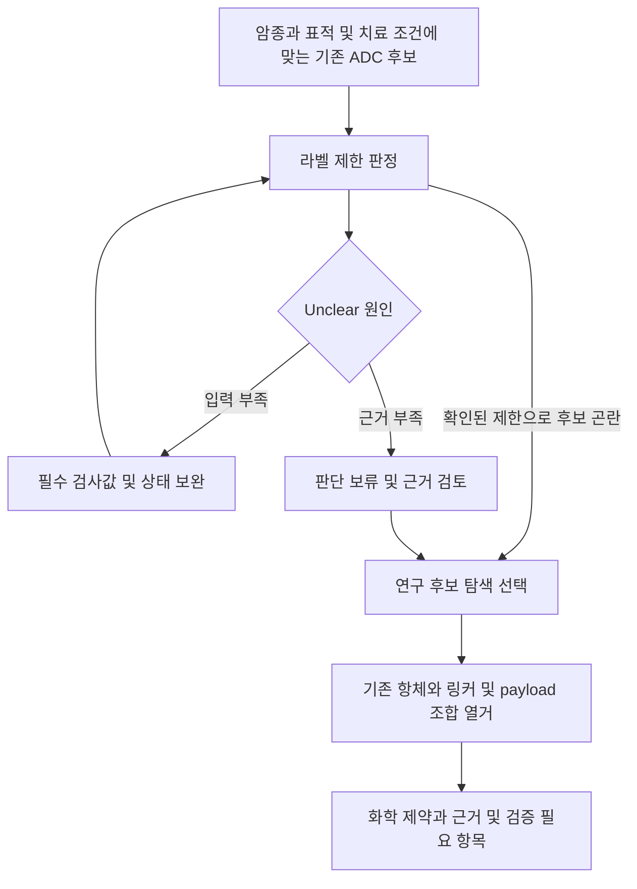

# ADCTOX 모델 정확도 개선 및 정량 평가 계획

작성일: 2026-10-12. 상태: **검토용 제안, 미실행**.

현재 구현과 기존 실험의 근거는 [연구 및 구현 현황](research_status_2026-10-12.md)에 있다. 여기의 데이터 규모, 통과 기준, 실험 순서는 앞으로 확정할 제안이다. 달성한 성능으로 인용하면 안 된다.

## 1. 이번 연구의 목표

최우선 목표는 자유 입력 질환을 관련 장기로 연결하는 정확도와 FinnGen 기반 장기 취약성 예측을 개선하고, 강한 baseline과 동일한 조건에서 정확도 및 실행 비용을 비교하는 것이다. 이후에 기존 ADC 비교와 새 조합 탐색을 연결한다.

용어는 다음과 같이 구분한다.

| 대상 | 실제 성격 | 개선할 부분 |
|---|---|---|
| MONDO | 질환 이름, 동의어, 계층 관계의 온톨로지 | 질환 연결 coverage, 동의어 처리, 장기 crosswalk의 정확성 |
| SapBERT | 질환 표현을 임베딩하는 사전학습 encoder | query → 질환 개념 검색 및 미확정 입력 거절 |
| BioLORD | 의미 기반 사전학습 encoder | 질환 표현의 일반화 및 취약성 모델 입력 |
| FinnGen | 현재는 질환쌍의 HR 요약 학습 자료 | 자료 품질, split, 목표값, 이를 학습하는 MLP/encoder의 성능 |

MONDO 자체나 FinnGen 데이터 자체를 파인튜닝하는 것은 아니다. **MONDO를 이용한 linker를 학습하고, FinnGen으로 예측 모델을 학습한다.** SapBERT의 원래 학습 목적은 생의학 개념 표현의 정렬이고, BioLORD는 정의 및 지식 기반 의미 표현을 사용한다. 이 역할 차이를 유지한다. [SapBERT 논문](https://aclanthology.org/2021.naacl-main.334/), [BioLORD 논문](https://arxiv.org/abs/2311.16075), [MONDO 공식 문서](https://mondo.monarchinitiative.org/pages/faq/).

공모전의 AI 학습 요건에는 현재도 직접 학습한 MLP가 해당할 가능성이 있다. 다만 정확한 인정 범위는 공고 확인이 필요하다. 추가 파인튜닝은 발표를 위한 명목상 단계가 아니라 검증 가능한 개선 가설이 있을 때 수행한다.

## 2. 이미 얻은 결과에서 출발한다

현재 저장된 선택 실험의 미관측 family 성능은 다음과 같다.

| 방법 | log(HR) R² | 장기 순위 ρ |
|---|---:|---:|
| SapBERT + MLP | 0.6218 | 0.7212 |
| BioLORD + MLP | 0.6549 | 0.7399 |
| BioLORD kNN | 0.6458 | 0.7489 |
| BioLORD LoRA + MLP | 0.6837 | 0.7431 |

근거는 [bake_biolord.json](../results/lab/bake_biolord.json), [bake_sapbert.json](../results/lab/bake_sapbert.json), [e_lora.json](../results/lab/e_lora.json)이다. LoRA − frozen의 장기 순위 차이는 +0.0032 [−0.0011, +0.0080]다. MLP가 kNN보다 장기 순위에서 낫다는 증거도 없다.

따라서 다음 순서로 진행한다.

1. 평가 목표와 정답을 먼저 확정한다.
2. 현행 파이프라인과 강한 baseline을 다시 측정한다.
3. 오류 종류를 보고 MONDO 정리, SapBERT 학습, FinnGen head 개선을 선택한다.
4. 확인용 데이터에서 개선을 검증한 후보만 제품에 반영한다.

encoder를 더 붙이는 실험부터 시작하면 이미 수행한 bake-off를 반복하면서 선택 편향만 늘릴 수 있다.

## 3. 세 개의 평가 과제를 분리한다

### A. 입력 질환 → 개념 → 관련 장기

입력이 `diabetic nephropathy`일 때 어느 질환 개념인지, renal 및 metabolic 같은 정답 장기 집합을 찾는 과제다. `lung hole`처럼 모호한 표현과 무의미한 문자열을 확정하지 않는 능력도 평가한다.

일차 지표는 **전체 질의의 장기 macro-F1**로 제안한다. 거절한 유효 질의는 누락으로 계산해 정확한 입력만 선택해서 점수를 부풀리지 않는다. 보조 지표는 concept top-1 accuracy, recall@5, 장기 micro-F1, Jaccard, exact-set match, 질환 단위 coverage다.

별도로 acceptance threshold별 precision–coverage 곡선, 무효 입력 false acceptance rate, 모호한 입력의 거절률을 보고한다. accepted subset의 점수만 제시하지 않는다. 동의어로 같은 질환을 표현한 질의가 많아도 동일 개념의 반복 표본으로 처리한다.

### B. 질환 → FinnGen 장기 취약성

질환에서 다른 outcome의 log(HR) 및 장기 순서를 예측하는 과제다. 질환이 속한 장기 분류와 동일한 정답이 아니다. 현재 자료는 endpoint 간 관찰적 연관성으로, ADC 독성의 인과적 예측값이 아니다. [Risteys 방법 문서](https://r10.risteys.finngen.fi/documentation#survival-analyses-between-endpoints).

일차 지표는 **미관측 family에서 배포 후처리를 반영한 질환별 장기 Spearman ρ**로 제안한다. 장기별 true excess score도 fold 학습 자료에서 얻은 baseline/spread를 이용해 정의한다. 보조 지표는 raw log(HR) R², RMSE, MAE, 장기 NDCG@3 및 top-3 겹침이다. NDCG의 비음수 relevance 변환과 동률 처리는 validation에서 확정해 고정한다.

제품이 양수 상위 3개만 적용하므로, clipping 후 전부 0인 질환 비율, 적용 장기 집합의 안정성, 미반영되는 축도 함께 보고한다. 상수 벡터의 Spearman을 임의의 0 또는 제외로 처리하지 말고 사전 정의된 규칙과 발생 개수를 남긴다. 후처리 전 13축 순위도 보조로 보고해 clipping의 영향을 드러낸다.

회귀를 정확도 85%처럼 표현하지 않는다. HR로부터 임의 threshold를 만든 이진 분류 성능과, 사람이 정한 장기 정답의 F1도 구분한다.

### C. 입력 → 최종 ADC 비교

실제 환자 profile에서 라벨 조건과 경고를 정확히 반영하는지 보는 통합 과제다. 우선 자동 규칙 정확성과 입력 불확실성 처리를 평가한다. 치료 후 독성 정답이 있는 독립 코호트가 확보되기 전에는 이를 임상적 추천 정확도라고 부르지 않는다.

미매핑 입력 반영 계수 `0 / 0.25 / 0.5`와 추후 confidence gate를 별도 비교한다. 실제 신규 입력에 대한 평가 없이 0.25가 최적이라고 가정하지 않는다. 기존 알려진 조건에서는 학습값 추가가 낮은 AUROC를 보였으므로 추가 장기 추정의 이득과 잘못된 순위 변경을 모두 측정한다.

## 4. 0단계: 재현성과 평가 자료를 먼저 고정한다

### 4.1 실행 manifest

아래 정보를 실험마다 기록한다.

- Git commit와 working-tree patch, 실행 파일 SHA256.
- FinnGen, MONDO, 라벨, registry의 버전 및 해시.
- HF 모델 revision, tokenizer, pooling, 최대 길이, 임베딩 정규화.
- split에 쓰인 concept/family ID, seed, fold 배정 CSV.
- 학습 및 튜닝 설정, parameter 수, precision, 장비와 소프트웨어 버전.
- raw OOF 예측, 후처리 예측, 질환별 지표, 실패 및 거절 사례.

현재 스냅샷은 [review_snapshot_2026-10-12.json](../results/review_snapshot_2026-10-12.json)에 있다. 실험 환경의 절대 경로는 config 또는 환경변수로 옮기는 것을 재현성 작업에 포함한다.

### 4.2 FinnGen 품질 및 누수 점검

동일 prior–outcome–lag의 중복, outcome 매핑 근거, QC 제외 사유, HR 및 CI 이상치, 관계 방향, lag 정의, 질환 family 추출 규칙을 점검한다. 현재 family는 코드 prefix 정규식으로 만들어지므로 의미적으로 가까운 parent/child와 동의 질환이 서로 다른 fold에 들어가는지도 확인한다.

59,157행의 88.20%가 HR > 1이며 장기별 표본 불균형이 크다. 이 선택된 표본 밖의 일반 질환쌍까지 성능이 유지된다고 주장하지 않는다. 실험별 장기 및 family 표본 수와 제외율을 같이 낸다.

학습 평균, scaling, precision weight clipping, baseline, spread, PCA 및 threshold는 모두 해당 fold의 training 자료에서만 계산한다. test 데이터의 HR 또는 정답 장기를 계산에 사용해 학습 입력을 만들지 않는다.

### 4.3 A 과제의 새 gold 제안

초기 규모는 **300~500개 개념, 1,500개 이상의 질의 표현**으로 제안한다. 이는 현재 확보된 gold 개수가 아니라 준비 목표다. 별도로 약 200개 이상의 모호한 표현, 비질환 입력, 무의미한 입력을 포함하고 규모는 pilot 후 조정한다.

| 질의 종류 | 예시 범위 | 확인할 오류 |
|---|---|---|
| 표준 이름 및 동의어 | disease canonical name, exact synonym | 용어 연결 누락 |
| 약어 및 철자 오류 | 임상 약어, 한두 글자 오타 | 잘못된 근접 질환 선택 |
| 일상 표현 | `lung hole` 같은 표현 | 모호성인데 단일 진단으로 확정 |
| 복합 장기 질환 | diabetic nephropathy 등 | 한 장기만 찾고 나머지 누락 |
| 단계 및 subtype | CKD stage, 질환 subtype | 다른 중증도나 좁은 개념으로 과도한 연결 |
| 증상 및 이력 | 검사 이상, 수술, 노출 | 질환으로 오인. 지원 범위를 gold에 표시 |
| 미지원 및 무효 입력 | 비의학 표현, 불명확 입력 | 그럴듯한 장기값을 강제로 적용 |

질의마다 유효성, 허용 concept ID 집합, 장기 집합, ambiguity, 근거, 검토자와 판정 이력을 둔다. 두 명이 독립 판독하고 불일치는 조정한다. 전문가 검토가 없으면 expert gold라고 부르지 않는다. 약어가 여러 진단을 뜻할 수 있으면 복수 정답 또는 거절을 정답으로 둔다.

MONDO crosswalk로 자동 생성한 장기 label만으로 같은 crosswalk를 평가하면 순환 검증이 된다. 사람의 독립 검토와 별도 근거가 필요하다. 합성 오타와 LLM 생성 표현은 학습 증강이나 stress test에 쓰되 최종 독립 정답을 대신하지 않는다.

외부 보조 평가로 [NCBI Disease Corpus](https://www.ncbi.nlm.nih.gov/CBBresearch/Dogan/DISEASE/)와 [MedMentions](https://github.com/chanzuckerberg/MedMentions/blob/master/README.md)를 검토한다. 전자는 MeSH/OMIM, 후자는 UMLS를 기준으로 하므로 MONDO와 직접 같은 label 체계가 아니다. crosswalk 가능한 부분과 불가능한 부분을 모두 보고하고, mention span을 제공받는 linking 평가와 NER 평가도 분리한다. 모델의 사전학습에 쓰인 지식 및 공개 benchmark 중복 가능성도 기록한다.

현재 자유 입력은 영어다. 한국어 지원은 별도 gold와 별도 평가가 확보될 때 추가하며 이번 영어 성능 표에 섞지 않는다.

## 5. split과 통계 프로토콜

| split | 용도 | 원칙 |
|---|---|---|
| 표현 holdout | 아는 질환의 새로운 표현 | 동일 정답의 test 표현을 학습 증강으로 사용하지 않음 |
| concept holdout | 학습에 없던 질환 | 같은 질환의 모든 학습 질의는 한 split |
| family holdout | 가까운 질환까지 제외한 일반화 | 관련 parent/child와 의미 중복도 점검 |
| 무효/모호 입력 holdout | 거절 성능 | threshold 선택에는 development subset만 사용 |
| 신규 출처 또는 신규 수집 test | 최종 확인 | 튜닝 중 열지 않는 별도 평가 자료 |

linker는 미관측 개념도 검색하도록 지식베이스에 존재할 수 있다. **KB에 label이 있는 것과 supervised fine-tuning에 test query가 들어가는 것은 다르다.** KB의 alias 가용 조건을 baseline 모두에 동일하게 적용하고, index에 있는 exact alias와 index에 없는 표현의 결과를 따로 보고한다.

FinnGen 평가에서는 동일 질환쌍의 lag 행이 서로 다른 fold로 나뉘지 않게 한다. 일차는 family holdout, prior holdout은 보조, pair holdout은 보간 성능 확인용이다. outer test는 설정 선택에 쓰지 않고 inner validation으로 하이퍼파라미터와 early stopping을 정한다.

기존 저장 결과는 선택 seed 0,1,2를 반복 확인한 것이다. 주석의 100,101,102 확인 실험이 실행되었다는 결과 파일은 찾지 못했다. 새 split seed 재실행은 robustness 점검으로 수행하되 **같은 데이터의 새 분할을 한 번도 보지 않은 독립 test라고 쓰지 않는다.** 독립 FinnGen 계열 데이터가 확보되지 않으면 B 과제의 한계를 탐색적/내부 일반화 평가로 명시한다. 신규 release도 같은 underlying cohort를 공유할 수 있으므로 독립성은 별도 확인한다.

CI는 A 과제에서 concept 또는 family, B 과제에서 family를 묶어 paired bootstrap한다. 개별 질의나 lag 행을 독립 표본으로 resample하지 않는다. 여러 seed는 별도 사람 또는 질환 표본이 아니다. 하나의 일차 가설과 지표를 먼저 등록하고, 후보를 많이 비교한 개발 결과와 최종 한 후보의 확인 결과를 분리한다. 양수 결과뿐 아니라 실패 실험도 남긴다.

## 6. baseline과 개선 실험

### 6.1 질환 연결 baseline

| ID | 방법 | 목적 |
|---|---|---|
| A0 | Registry 및 MONDO exact alias lookup | 학습 없이 해결되는 부분 확인 |
| A1 | 문자/단어 TF-IDF 검색 | 가벼운 어휘 검색 기준 |
| A2 | 현재 SapBERT top-1 + 고정 threshold | 현행 ontology linker |
| A3 | frozen BioLORD 검색 | encoder 교체만의 효과 |
| A4 | 현재 전체 `resolve()` | 실제 제품 baseline |
| A5 | MONDO 정리 + top-k 및 거절 정책 | 데이터와 정책 개선 효과 |
| A6 | fine-tuned SapBERT + 같은 정책 | 추가 학습의 순수한 효과 |

장기 classifier를 따로 학습하면 A 과제의 baseline으로 추가할 수 있다. 그러나 FinnGen 취약성 MLP와 같은 과제로 취급하지 않는다.

### 6.2 먼저 할 MONDO 개선

동일 문자열의 다른 concept 충돌, obsolete/replaced ID, crosswalk 누락, ancestor 이름 변경을 점검한다. 현재 ancestor 이름 기반 연결은 가능하면 검증한 stable ID 중심으로 바꾸고 다중 장기를 유지한다. MONDO의 exact, broad, narrow, related synonym을 동일한 정답으로 합치지 않는다. [MONDO 동의어 구분](https://mondo.monarchinitiative.org/pages/faq/).

새 encoder 없이 exact alias 정규화, top-k 후보의 concept 단위 중복 제거, top-1 similarity 및 top-1/top-2 margin, 미매핑 사유 구분을 시험한다. 동일 concept의 alias 여러 개가 top-k를 채우는 현상을 피한다. similarity, margin 및 coverage threshold는 development에서 정하고 test에서는 고정한다.

`lung hole`은 폐 장기를 연상시키더라도 특정 진단으로 단정하기 어렵다. 정답을 억지로 pneumothorax로 고정하지 않고 가능한 후보 또는 미확정 처리가 맞는지 사람이 판정한다.

### 6.3 SapBERT 추가 학습

학습 단위는 검토된 `(질의 표현, 정답 concept)` 쌍이다. 정확 동의어와 사람이 확인한 표현을 positive로, 유사하지만 다른 질환, 단계, subtype, 인접 장기 질환을 hard negative로 만든다. multi-positive contrastive loss 또는 metric learning을 후보로 둔다. broad/narrow 관계를 자동으로 exact positive로 만들지 않는다.

처음에는 작은 설정의 LoRA 또는 마지막 일부 층 학습을 비교한다. 동일 데이터, 같은 pooling, 같은 후보 index와 동일한 튜닝 예산으로 frozen SapBERT와 비교한다. encoder가 달라지면 query 임베딩과 MONDO index를 함께 다시 만들어야 한다. 기존 인덱스에 새 query encoder만 붙이면 임베딩 공간이 어긋난다.

concept holdout 실험의 추가 학습에는 training concept의 positive 및 negative 쌍만 사용한다. development/test concept의 동의어 쌍을 추가 학습에 섞지 않는다. 검색 KB에 test concept의 이름이 존재하는 조건은 별도로 명시한다. 기존 사전학습 encoder가 UMLS 등에서 해당 개념을 접했을 가능성까지 제거한 실험이라고 주장하지 않는다.

오류 대부분이 top-5 안에서의 혼동이면 그때만 작은 reranker를 시험한다. 오답이 top-5에 없으면 reranker로 해결할 수 없다. 별도 모델 추가는 error analysis에서 필요성이 드러난 경우에 한정한다.

### 6.4 FinnGen 예측 baseline

| ID | 방법 | 반드시 포함할 이유 |
|---|---|---|
| B0 | 학습 자료만 이용한 outcome/chapter/lag lookup | 기존 논문식 기준과 연결 |
| B1 | TF-IDF + Ridge 또는 LightGBM | 사전학습 임베딩 효과 구분 |
| B2 | frozen SapBERT kNN 및 MLP | 과거 주 모델과 비교 |
| B3 | frozen BioLORD kNN | 기존 organ ranking에서 강한 기준 |
| B4 | 현재 BioLORD MLP | 실제 배포 구조 |
| B5 | 재현한 BioLORD LoRA + MLP | 이미 얻은 R² 개선의 재검증 |

현재 baseline은 outer train 전체, MLP는 inner validation을 뺀 자료로 학습한다. 새 평가에서는 inner validation으로 설정 및 epoch를 고른 후 outer train 전체로 refit하는 방법 또는 동일 정보량의 대조 방법을 명시한다. single head와 5-head ensemble도 구분하며 baseline의 ensemble 여부와 비용을 보고한다.

### 6.5 FinnGen 개선 ablation 순서

1. **평가 일치:** 현행 모델의 raw 예측과 실제 배포 후처리를 동일한 OOF harness로 비교한다. fold별 baseline/spread만 사용한다.
2. **context 수정 재학습:** legacy lag-only와 올바른 lag+domain 구성을 재학습해 비교한다. 기존 체크포인트의 추론 입력은 유지한다.
3. **목표 함수 조정:** log(HR) Huber loss에 질환별 장기 ranking loss를 더하는 후보를 비교한다. 학습 중에도 장기 aggregation을 명확히 정의한다.
4. **표본 처리:** 질환별 균등 가중, domain 균형 및 CI precision weighting을 한 번에 하나씩 비교한다. 희소 장기의 HR 불확실성을 무시한 oversampling은 피한다.
5. **LoRA 재평가:** 위의 목표 함수와 동일 예산에서 frozen/LoRA를 비교한다. encoder 조정이 순위 지표를 개선하는지 확인한다.
6. **선택적 추가 모델:** 실패 패턴이 남을 때 kNN와 MLP의 gated blend, 작은 장기 head 등을 검토한다. blending 계수는 inner validation에서만 선택한다.

MONDO feature와 definitions 추가는 이미 평균적으로 확실한 개선이 없었다. 같은 입력을 그대로 더하는 실험의 우선순위는 낮다. 단순히 model 수를 늘리는 것은 독립적인 개선 가설이 아니다.

## 7. 속도와 자원 벤치마크

정확도 비교에 참여한 동일 pipeline을 측정한다. kNN의 임베딩 계산을 빼고 MLP의 임베딩 계산은 포함하는 식으로 비교하지 않는다. head-only 비용은 별도 표로 낸다.

| 실행 조건 | 측정 내용 |
|---|---|
| Cold start | 새 프로세스의 모델 및 index 로드 + 첫 질의. 로컬 모델 파일은 준비한 상태, OS file cache 조건 별도 기록 |
| Warm, cache miss | 프로세스와 모델은 살아 있고 새로운 질의를 분석 |
| Warm, cache hit | 같은 질의의 결과 재사용 |
| Batch | batch 1, 8, 32의 latency와 throughput |

CPU와 GPU 결과는 각각 낸다. 같은 GPU 1장, CPU thread 수, precision, token 길이 조건을 맞춘다. PyTorch CUDA timing에는 synchronize를 사용하고, 실행 순서를 섞어 장비 부하와 순서 효과를 줄인다. 다른 사용자의 GPU 사용량도 기록한다.

초기 측정량은 cold start 10회, 200개 이상의 다양한 warm 질의를 5회 반복하는 것으로 제안한다. pilot 분산에 따라 표본 수를 정하고 최종 비교 전 고정한다. p50, p95, queries/s, 전체 및 증분 peak RSS, peak VRAM, checkpoint 및 index 크기, trainable/total parameter 수, 학습 GPU-hours를 보고한다. 시간 CI도 질의 단위 반복을 고려한다. UI redraw 시간과 AI 계산 시간은 분리한다.

현재 코드에서 우선 확인할 최적화 가설은 다음과 같다.

- BioLORD/SapBERT 객체와 MLP 체크포인트를 프로세스에서 재사용한다.
- registry 검색과 MLP 입력에서 같은 BioLORD 임베딩을 재사용한다.
- 매 질의마다 MONDO 전체 matrix를 float32로 변환하는 작업을 줄인다.
- 동일 입력 캐시의 상한 및 무효화 기준을 정한다.
- 이후에만 ANN index, quantization, distillation을 검토한다. ANN 검색은 exact search 대비 recall을 측정한다.

이들은 코드에서 확인한 병목 후보이며 아직 실측한 개선 결과는 아니다. 최적화 전후 출력 일치와 정확도 비열등성을 함께 확인한다.

## 8. 개선 판정 기준과 발표 방식

아래 숫자는 **사전 등록 후보 기준**이다. pilot과 전문가 검토 후 최종 test를 열기 전에 확정한다. 임상적 안전 기준이 아니다.

| 목표 | 제안 기준 | 주장 가능한 내용 |
|---|---|---|
| A 정확도 | 현행 전체 pipeline 대비 macro-F1 +2 percentage points 이상, paired CI 하한 > 0 | 정의된 입력 분포에서 장기 연결 성능 개선 |
| A 선택적 적용 | accepted precision 95% 이상을 목표로 하되 coverage 함께 보고. 무효 입력 false acceptance 5% 이하 목표 | 지정 threshold에서의 거절 및 적용 특성 |
| B 정확도 | 강한 BioLORD kNN과 현행 MLP 모두에 organ ρ +0.01 이상, 일차 paired CI 하한 > 0 | 해당 holdout 조건의 장기 순위 개선 |
| 효율성 | 정확도 저하 허용 폭을 사전 정의하고 warm latency 또는 RAM 30% 이상 감소 목표 | 비열등 정확도에서 더 낮은 실행 비용 |

효율성의 non-inferiority margin은 지표별로 정한다. 예를 들어 B의 ρ 0.01 감소 허용과 A의 F1 허용 폭을 같다고 가정하지 않는다. 평균 차이만 보고 비열등하다고 하지 않고 CI로 확인한다. 95% precision도 점 추정만으로 보장하지 않는다.

공모전 결과 표는 아래 열을 갖도록 한다.

```text
Model / Training data / Split / Main metric [95% CI] /
Δ vs strongest baseline [95% CI] / Coverage /
Cold p50 / Warm p50,p95 / Peak RAM,VRAM / Training cost
```

“우리가 학습한 모델이 baseline보다 우수하다”는 결론은 결과에 따라 달라진다. 순위 개선이 없고 R²만 개선되면 회귀 성능 개선으로 한정한다. 정확도가 비슷하고 빠르면 효율성 결과로 발표한다. kNN이 더 좋으면 그 사실을 보고하고 학습 모델의 사용 범위를 재검토한다. 라벨 규칙의 정확성과 모델 예측 정확도를 하나의 백분율로 합치지 않는다.

## 9. 실행 순서와 산출물

아래는 약 4~6주 규모의 작업 순서 예시다. gold 판독자와 독립 자료의 확보 상황에 따라 달라지며 확정 일정은 아니다.

| 순서 | 작업 | 산출물 및 다음 단계 조건 |
|---|---|---|
| 1 | 재현 manifest, 데이터 누수 및 QC 감사, 기존 비교 재현 | 데이터 카드, split 목록, 현재 baseline 표 |
| 2 | 새 질의 gold pilot 및 판독, test 봉인 | annotation guide, gold v1, 판독 일치도, 오류 분류 |
| 3 | MONDO 정책 개선과 SapBERT 학습 | A0~A6 ablation, precision–coverage, OOS 거절 표 |
| 4 | 실제 배포 후처리를 포함한 FinnGen 평가와 head/context 실험 | B0~B5 공정 비교 및 후속 ranking loss 결과 |
| 5 | 후보 하나의 확인 평가, CPU/GPU 비용 측정 | 최종 성능 및 속도 표, 성공/실패 판정 |
| 6 | 검증된 후보만 통합하고 공모전 설명 정리 | 모델 카드, 한계, 재현 명령, 연구 발표 자료 |

가장 먼저 실행할 단위 작업은 **기존 BioLORD MLP와 kNN의 배포 후처리 OOF 평가를 만들고, 자유 입력 gold pilot을 구성하는 것**이다. 시간이 부족하면 이 두 작업과 MONDO mapping 오류 수정까지를 1차 범위로 삼는다. 추가 encoder bake-off와 새 ADC 설계 UI는 뒤로 미룬다.

새 실험의 제안 파일 구조는 다음과 같다. 아직 생성된 구현 파일이 아니다.

```text
ml/benchmarks/                 # schema, protocol, split manifest
data/curated/disease_linking/   # 검토된 질의와 concept/장기 gold
ml/eval_linking.py             # A 과제 평가
ml/eval_vulnerability.py       # B 과제의 fold-safe 후처리 평가
ml/benchmark_runtime.py        # 모델/전체 pipeline 비용 평가
ml/results/benchmarks/<run>/   # config, OOF, metrics, CI, timing, errors
ml/docs/experiments.md         # 모든 실험과 의사결정 기록
```

## 10. `Unclear`에서 새 ADC 설계로 이어지는 방식

### 10.1 전환 조건을 먼저 구분한다

**1등 ADC가 `Unclear`라고 해서 사용할 수 있는 ADC가 없다고 결론내릴 수 없다.** 현재 상태는 검사값 부족, 라벨의 자료 부족, 해당 상태에 대한 라벨 언급 부재를 포함한다. `Avoid`도 미입력 검사값에 따른 최악의 가능성일 수 있으므로 확정 금기와 구분해야 한다.

제안하는 분기 순서는 다음과 같다.



추천기에는 먼저 indication/target 적합성 필터가 필요하다. 다음으로 `Unclear` 원인을 기계적으로 구분할 수 있게 유지한다. 입력 부족이면 추가 검사 안내, 근거 부족이면 판단 보류로 표시한다. 그 상태에서 사용자가 **연구용 새 조합 탐색**을 선택할 수 있도록 하는 방식이 적절하다. 화면에 1등 상태 하나만 보고 자동으로 “대체 신약이 필요함”이라고 표시하는 방식은 피한다.

### 10.2 최초 설계 기능의 범위

사용자 목표인 “기존 항체, 링커, payload의 새 조합”에 맞춰 다음을 구성한다.

1. 표적과 실제 항체 catalog를 고른다. 이름, 서열/구조 출처, epitope 정보, conjugation site 가용성, 임상 선례를 기록한다.
2. 기존 payload 및 linker의 reactive handle, cleavability, conjugation chemistry, DAR 범위, 임상 선례를 정리한다.
3. `src/adctox/design/`의 규칙을 재사용해 후보와 제외 사유를 열거한다.
4. 기존 알려진 조합과 새 조합을 구분하고 novelty의 근거를 기록한다. catalog에 없다는 이유만으로 세계 최초라고 주장하지 않는다.
5. 후보마다 근거가 있는 경고, 확인되지 않은 항목, 구조 및 실험 검증 계획을 표시한다.

현재 열거기는 한 target에서 106개 조합을 만들 수 있지만 실제 항체 identity를 담지 않는다. 이 공백을 채우는 것이 설계 기능의 첫 구현 과제다. 제약 통과는 합성 성공이나 저독성의 증거가 아니다.

### 10.3 AlphaFold를 붙일 위치

구조 검토는 조합 열거 후 소수 후보를 줄이는 보조 단계로 둔다. 항체/항원 구조와 결합 부위, 명시된 conjugation site, linker/payload의 화학 표현이 있어야 비교 질문을 만들 수 있다. DAR 평균이 같아도 결합 위치 및 분포가 다르면 구조가 달라질 수 있다.

AlphaFold 3는 생체분자 복합체와 일부 화학 성분의 구조를 다루지만, 임의 ADC 접합체를 넣으면 결합 성공과 안정성이 자동 판정되는 도구는 아니다. pLDDT, PAE, ipTM은 예측 confidence이며 친화도, 응집, 약물 방출, 독성의 측정값이 아니다. [원 논문](https://www.nature.com/articles/s41586-024-07487-w), [공식 confidence 설명](https://www.ebi.ac.uk/training/online/courses/alphafold/alphafold-3-and-alphafold-server/how-to-assess-the-quality-of-alphafold-3-predictions/).

site 주변의 steric clash, 항원 결합 부위 간섭, 구조 confidence, 후보 간 일관성을 구조 검토 항목으로 제안한다. 사용한 도구가 해당 화학과 covalent linkage를 지원하는지 먼저 확인해야 한다. 필요하면 후속 MD와 응집/안정성/결합/방출 실험으로 검증한다. 이 단계는 현재 최우선인 질환 연결 및 취약성 benchmark를 마친 뒤 수행한다.

### 10.4 새 조합 결과에 허용할 주장

현재 연구로 가능한 표현은 “지정한 구성 요소와 제약을 만족하는 연구 후보”, “이 부분의 근거가 부족해 검증이 필요한 후보”다. 새로운 조합에 기존 약물의 `Clear` 상태를 상속시키거나, 기존 라벨의 부재를 독성 부재로 처리하면 안 된다. FinnGen 장기 취약성과 AlphaFold 구조 confidence만으로 새 ADC가 더 안전하다고 결론내릴 수 없다.

## 11. Fable 검토에서 먼저 결정할 사항

1. A의 장기 macro-F1과 B의 배포 후처리 organ ρ가 각각 적절한 일차 지표인가?
2. 신규 gold와 독립 확인 자료를 실제로 확보할 수 있는가? 확보 불가 시 주장 범위가 충분히 좁혀져 있는가?
3. 현행 MLP를 kNN보다 유지할 실익이 무엇인가? 학습 요건, 성능, 속도 중 무엇을 검증할 것인가?
4. SapBERT 학습 데이터와 MONDO index 사이의 누수 및 concept equivalence 처리가 타당한가?
5. 0.25 자동 반영은 어떤 검증 조건을 만족해야 유지할 수 있는가?
6. `Unclear`에서 입력 보완과 연구 후보 탐색으로 나누는 분기가 정확한가?
7. 새 ADC 설계가 현재 자료로 뒷받침되지 않는 안전성 주장으로 넘어가지 않도록 범위가 정해졌는가?

검토 요청 양식은 [fable_review_2026-10-12.md](fable_review_2026-10-12.md)에 있다.
