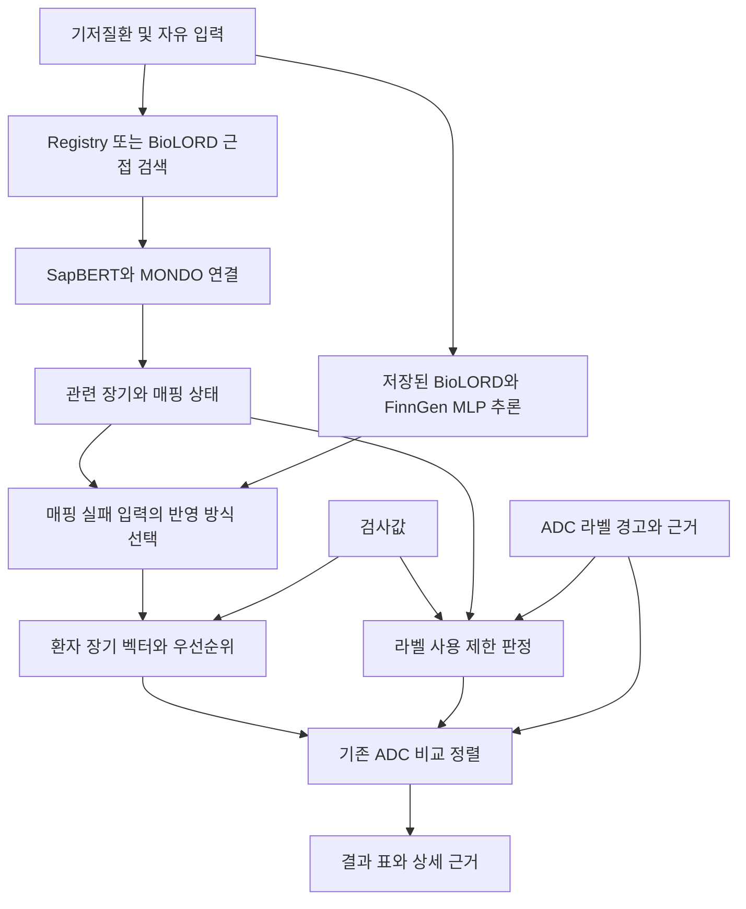

# ADCTOX 구현 및 연구 현황

작성 기준: 2026-10-12, Ubuntu 작업 디렉터리 `/home/hyeongchanahn/CONI/adctox`.

이 문서는 같은 날 GitHub 배포 및 모델 업데이트 기능을 추가하기 **전** 상태의 연구 스냅샷이다. 이후 앱 버전은 0.1로 변경되었고 모델 파일 경로와 배포 loader, CLI 및 업데이트 화면이 추가되었다. 최신 설치 및 배포 동작은 [설치 안내](../../docs/INSTALL.md)와 [배포 안내](../../docs/DISTRIBUTION.md)를 기준으로 한다. 아래 소스 해시는 당시 상태를 식별하며 이후 코드와 같다고 가정하지 않는다.

이 문서는 현재 코드, 저장된 실험 결과, 최근 대화에서 반영한 변경을 함께 정리한 검토 자료다. 새로운 학습 실험의 결과를 보고하는 문서는 아니다. 향후 계획은 [모델 개선 계획](model_accuracy_plan_2026-10-12.md), Fable에게 전달할 검토 요청은 [검토 지침](fable_review_2026-10-12.md)에 있다. 수치와 소스 해시는 [검토 스냅샷](../results/review_snapshot_2026-10-12.json)에 모았다.

## 1. 현재 프로젝트의 중심

현재 제품의 중심은 `ml/recommend.py`로 실행하는 터미널 추천기다. 기저질환과 검사값을 입력하고, 질환과 관련된 장기를 정리한 다음, 기존 ADC의 라벨 사용 제한과 장기별 경고를 비교한다. 공모전의 장기 목표는 **기존 항체, 링커, payload의 새로운 조합을 제안하는 것**이다. 현재 터미널에 새 조합 설계 단계가 연결되어 있지는 않다.

저장소에는 두 경로가 공존한다.

| 경로 | 역할 | 현재 해석 |
|---|---|---|
| `ml/` | FinnGen 기반 장기 취약성 학습, MONDO 연결, 라벨 기반 기존 ADC 비교, 터미널 UI | 현재 개발의 중심 |
| `src/adctox/` | 임상시험 자료 처리, 구조 특징 기반 독성 모델, 제약 조건을 이용한 설계 후보 열거, API 및 과거 연구 | 연구 기반과 향후 설계 단계에서 재사용할 코드 |

기존 ADC의 전체 순서는 현재 **라벨 규칙과 경고를 정렬하는 알고리즘**이 만든다. AI가 ADC의 효과와 독성을 직접 학습해서 최종 치료제를 선택하는 구조는 아니다. AI는 자유 입력 질환의 의미 표현, 질환 연결, 장기 취약성 추정에 쓰인다.

현재 입력에는 암종, 표적 항원 발현, 치료 차수에 따른 후보 적합성 필터가 없다. 따라서 서로 다른 표적의 14개 라벨 항목을 비교한 결과를 그대로 환자의 치료 대안 목록이라고 해석할 수 없다. 이는 새 설계 단계에 앞서 해결해야 하는 기능적 공백이다.

## 2. 실행 방법과 환경

### 기본 실행

```bash
cd /home/hyeongchanahn/CONI/adctox
/data/hyeongchanahn/envs/adctox/bin/python -I ml/recommend.py
```

어느 디렉터리에서든 실행하려면 다음 명령을 사용한다.

```bash
/data/hyeongchanahn/envs/adctox/bin/python -I /home/hyeongchanahn/CONI/adctox/ml/recommend.py
```

`recommend.py` 경로만 직접 실행했을 때의 `Permission denied`는 Python 인터프리터를 거치지 않았기 때문이다. 현재 파일은 실행용 shebang과 실행 권한을 갖춘 독립 실행 파일이 아니다. 위 명령으로 실행하면 된다.

등록된 조건 목록은 다음과 같이 확인한다.

```bash
/data/hyeongchanahn/envs/adctox/bin/python -I ml/recommend.py --list
```

일반 텍스트 출력 예시는 다음과 같다. 숫자 단위는 해당 옵션의 입력 계약을 따라야 한다.

```bash
/data/hyeongchanahn/envs/adctox/bin/python -I ml/recommend.py --plain cirrhosis ckd_stage_3 --crcl 45 --bili 1.2
```

`--crcl`은 mL/min, `--bili`는 정상 상한 대비 배수다. 원검사값은 `--lab key=value` 경로도 지원한다. `--detail`, `--priority`, `--learned`, `--learned-fallback` 등은 [parse_args](../recommend.py)에 구현되어 있다. **현재 `--help`는 구현되어 있지 않아 질환 문자열처럼 처리될 수 있다.** 실행 안내에 `--help`를 사용하면 안 된다.

### 의존 파일

| 위치 | 내용 |
|---|---|
| `/data/hyeongchanahn/envs/adctox/` | PyTorch, Transformers, Sentence Transformers 등이 설치된 실제 추론 환경 |
| 저장소 `.venv/` | pytest 및 가벼운 데이터 처리 도구. 전체 AI 추론 의존성이 모두 있지는 않음 |
| `/data/hyeongchanahn/adctox/ml_cache/` | FinnGen 캐시, 임베딩, MONDO 인덱스, 학습된 체크포인트, 실험별 예측 캐시 |
| `data/raw/atlas/2026-10-10/` | 협업자가 제공한 원본 워크북 |
| `data/raw_big/mondo/2026-10-07/mondo.obo` | 현재 인덱스 구축에 사용한 MONDO 스냅샷 |
| `/data/hyeongchanahn/adctox/raw/dailymed/2026-10-07/` | ADC 라벨 HTML 및 버전 manifest |

현재 ML 스크립트 여러 곳에 절대 경로가 들어 있다. 다른 컴퓨터에서는 코드만 복사해도 같은 상태가 재현되지 않는다. 원본 워크북과 캐시의 취급 기준은 [TEAMMATE_DATA_USE](../../docs/TEAMMATE_DATA_USE.md)를 따른다.

현재 환경의 PyTorch는 `2.11.0+cu128`이며 GPU가 보이면 GPU, 그렇지 않으면 CPU 추론을 사용한다. 조사 당시 서버에는 RTX 4090 4장이 보였지만 공유 장비이므로 벤치마크에서 가용 자원이 일정하다고 가정하면 안 된다. HF 모델이 로컬 캐시에 있으면 `HF_HUB_OFFLINE=1 TRANSFORMERS_OFFLINE=1`로 네트워크 없이 실행을 확인할 수 있다.

### 기존 데이터 및 모델 재생성 경로

이 명령들은 역할 설명용이다. 이번 문서 작성에서는 캐시 재생성이나 재학습을 실행하지 않았다.

| 스크립트 | 작업 | 주의점 |
|---|---|---|
| `ml/prepare_data.py` | 워크북을 `finngen.parquet`, `tox.pkl`, `master.pkl`로 변환 | 기존 캐시를 다시 씀 |
| `ml/embed_terms.py` | 학습에 필요한 기본 용어 임베딩 준비 | 추가 encoder 실험의 임베딩 캐시는 별도 확인 필요 |
| `ml/mondo_index.py build` | SapBERT 기반 MONDO 인덱스 구축 | 인수 없는 실행은 build가 아니라 예시 질환 연결 |
| `ml/lab.py` | 고정 임베딩과 학습 head의 교차검증 실험 | 결과 이름과 seed를 명시해야 함 |
| `ml/lab_ft.py` | fold별 새로운 encoder에서 LoRA 실험 | 배포 모델과 별개 |
| `ml/vulnerability_model.py` | 배포용 5개 MLP ensemble 학습 및 JSON 생성 | 인수 없는 실행은 기존 체크포인트를 덮어쓸 수 있음 |
| `ml/vulnerability_model.py --predict-only` | 기존 체크포인트로 registry 예측 JSON 재생성 | 이것도 결과 JSON을 다시 씀 |

## 3. 실제 처리 흐름



### 3.1 질환 연결과 장기 취약성은 서로 다른 역할이다

MONDO는 질환 이름과 계층 관계를 정리한 온톨로지다. 학습시키는 신경망 자체가 아니다. SapBERT는 질환 표현을 개념에 연결할 때, BioLORD는 질환의 의미 임베딩과 FinnGen 예측 입력에 사용한다. [MONDO 공식 설명](https://mondo.monarchinitiative.org/pages/faq/), [SapBERT 원 논문](https://aclanthology.org/2021.naacl-main.334/), [BioLORD 모델 카드](https://huggingface.co/FremyCompany/BioLORD-2023).

현재 `resolve()`의 순서는 다음과 같다.

1. Registry ID 또는 대소문자를 무시한 정확한 이름이면 수동 정리된 장기와 severity를 사용한다.
2. 자유 입력이 BioLORD registry 검색에서 cosine 0.80 이상이면 해당 registry 장기와 ID를 사용한다.
3. SapBERT MONDO 검색이 0.75 이상이고 장기 crosswalk가 있으면 그 장기를 사용한다. severity는 고정값 0.80이다.
4. 위 연결이 실패해도 BioLORD registry cosine이 0.60 이상이면 장기만 빌리고 확정 registry ID는 만들지 않는다.
5. 나머지는 매핑 실패로 남는다.

숫자 0.80, 0.75, 0.60은 연결 정책의 임계값이다. 질환 진단 확률이나 임상적 정확도가 아니다. Registry에는 질환 외에 이전 방사선 치료, 수술, 약물 노출 같은 이력도 들어 있다.

### 3.2 학습된 모델이 실제로 하는 일

배포 체크포인트는 **고정된 BioLORD-2023 + 직접 학습한 TwoTower MLP head 5개**의 ensemble이다. encoder 전체를 파인튜닝한 모델이 현재 배포된 것은 아니다. 각 head는 다른 seed로 학습하고, 질환 이름과 outcome 이름의 임베딩, lag context를 입력받아 FinnGen의 `log(HR)`를 예측한다.

현재 배포 학습은 각 seed에서 prior의 약 10%를 validation으로 빼고 가장 좋은 head를 저장한다. 각 head를 모든 prior로 다시 학습한 구조는 아니다. 배포용 baseline/spread 메타데이터는 전체 학습 자료에서 만들지만, 교차검증에서는 이를 fold별 training 자료로 다시 계산해야 한다.

최종 장기 값은 다음 과정으로 만든다.

1. 193개 outcome 및 lag에 대한 예측을 ensemble 평균한다.
2. outcome별 평균 log(HR)를 빼서 상대적인 초과 값을 구한다.
3. 13개 장기로 묶고 학습 자료의 장기별 변동 크기로 나눈다.
4. 해당 질환의 장기 값 중앙값을 빼고 0~1로 자른다.

따라서 화면의 `0.72`는 폐 독성이 72%라는 뜻이 아니다. 질환별 상대적인 장기 취약성 추정값이다. 관련 코드는 [vulnerability_model.py](../vulnerability_model.py)에 있다.

현재 학습 코드의 context 구성에는 domain one-hot을 잘라내는 문제가 있다. 기존 체크포인트는 lag one-hot만 본 상태로 학습되었다. 추론은 이 학습 입력에 맞추도록 수정되어 있다. domain을 정상적으로 넣는 개선은 **재학습해서 비교할 새 실험**이며 추론 입력만 바꾸면 안 된다.

### 3.3 알려지지 않은 입력의 반영

이미 매핑된 조건에는 학습된 추가 장기 값을 기본적으로 섞지 않는다. 전역 기본값은 `LEARNED_FRACTION = 0.0`이다. 자유 입력은 저장된 ensemble을 실제로 실행해 분석 화면에서 검토할 수 있다. 같은 프로세스에서 같은 입력을 다시 보면 캐시를 사용한다.

매핑되지 않은 입력의 선택지는 다음과 같다.

| 메뉴 | 현재 계수 | 실제 반영 |
|---|---:|---|
| 자동 | 0.25 | 양수인 상위 3개 장기에 낮게 반영 |
| 반영 | 0.50 | 양수인 상위 3개 장기에 더 크게 반영 |
| 반영 안함 | 0 | 반영하지 않음 |

계수를 곱한 값이 0.01 미만이면 제외한다. 이 추정으로 확정 질환 ID나 라벨 판정용 `own_axes`를 만들지 않는다. 결과에 `Unvalidated estimate`로 남긴다. 여러 질환의 장기 값은 합산 대신 장기별 최댓값으로 합친다.

현재 `자동`은 입력이 의미 있는 질환인지 판별하는 기능이 아니다. 무의미한 문자열도 추정값이 나올 수 있으므로 이 경로의 정확도와 거절 성능을 별도 평가해야 한다.

### 3.4 검사값, 라벨 판정, ADC 순서

현재 원검사 입력은 21개다. `ml/labs.py`가 단위를 변환하고 필요한 제한 판정 입력을 만든다. 비정상 검사값은 해당 장기에도 표시한다. CKD 이름만 보고 CLcr를 임의로 채우지 않는다.

`ml/restrictions.py`는 확인된 질환 및 관련 장기와 실제 검사값을 사용해 97개 규칙을 평가한다. 없는 검사값은 가능한 범위로 다룬다. 이번 점검에서 **97개 규칙의 인용문이 라벨 원문에서 모두 확인되었다.** 이는 규칙 해석의 의학적 정확성 전체가 검증되었다는 의미는 아니다.

화면의 짧은 상태는 `Clear / Monitor / Unclear / Avoid`다. 내부에는 `no_adjustment`, `monitor`, `reduce_dose`, `no_statement`, `insufficient_data`, `avoid`, `contraindicated`가 따로 남는다. 용량 조절과 금기 같은 구체적 행동은 상세 근거와 출력에서 보존한다. 적용되는 판정 자체가 없으면 `-`일 수 있다. `Clear`도 모든 상황에서 안전하다는 보증은 아니다.

현재 정렬 키는 다음 순서다.

```text
최악의 가능한 라벨 제한 등급
→ 현재 확인된 라벨 제한 등급
→ 환자 우선순위 등급별 강한 라벨 경고 장기 수의 tuple
→ 환자 우선순위 등급별 일반 경고 장기 수의 tuple
→ ADC 이름
```

`B`, `Wn`이라는 severity 합산 값은 코드에 남아 있으나 **현재 같은 환자 안에서 ADC를 정렬하는 키가 아니다.** 과거 설명의 점수 합산 공식과 구분해야 한다. 직접 근거는 [recommend()](../recommend.py)다.

### 3.5 약물 측 근거

[drug_evidence.py](../drug_evidence.py)는 라벨의 강한 경고와 section 5 경고를 장기에 연결하고, 라벨 표에서 grade 3 이상 발생률을 읽는다. Grade 3과 Grade 4는 같은 표 안에서만 합산한다. 단독요법 표를 우선하며 병용요법이나 검사 이상 표에서 가져온 값은 표시한다. 표나 장기 항목이 없으면 `no data` 또는 `not reported`로 남기며 0%로 바꾸지 않는다.

현재 터미널 정렬은 라벨 제한과 경고를 우선한다. 발생률 수치가 존재한다는 사실만으로 새로운 ADC 구조의 발생률까지 예측할 수 있는 것은 아니다.

## 4. 지금까지 반영한 터미널 변경

아래는 현재 코드에서 확인한 최종 상태다. 모든 항목이 별도 커밋으로 남아 있는 것은 아니므로 변경 날짜나 작성자를 소급해서 단정하지 않는다.

| 영역 | 반영 내용 |
|---|---|
| 전체 디자인 | 기존 Fable 디자인과 어두운 터미널 분위기를 유지. 장식 추가를 줄이고 가운데 점과 emoji 대신 단순한 문자 사용 |
| 헤더 | 왼쪽 `ADCTOX`, 오른쪽 숫자 `0.0`. 중복되는 `ADC 추천`, `ADC 추천 결과` 삭제 |
| 기저질환 선택 | 선택창의 긴 괄호 설명 축소. backend 판정에 필요한 기준은 유지 |
| 검사값 | 여러 항목을 입력하는 폼과 입력 개수 요약. 결과 상단에는 선택한 ADC와 관련된 핵심값 최대 3개 및 추가 개수 표시 |
| 우선순위 | 같은 등급을 콤마로 묶고 순위별로 세로 표시. 자동 우선순위 안내도 그룹화. 수동 조정 지원 |
| 분석 진행 | 실제 BioLORD, SapBERT/MONDO, FinnGen MLP 처리 단계와 ASCII spinner 표시. 재조회는 `Cached`로 구분 |
| 자원 표시 | 분석 화면에 프로세스 CPU와 resident RAM 사용량을 짧게 표시. 아래의 긴 회색 안내 제거 |
| 미매핑 입력 | `자동 / 반영 / 반영 안함`으로 변경. 자동은 0.25 계수, 반영은 0.5 계수 |
| 결과 상단 | `Key values`와 `Organ priority`를 세로 구분선으로 나눈 두 영역. 좁은 화면에서는 위아래 배치 |
| 결과 표 | 영어 표기. 환자 관련 경고 장기 최대 2개와 나머지 장기 중 경고 1개 표시 |
| 경고 표시 | `!!`, `!`, `+` 사용. 선택한 행에서도 경고 색이 유지되도록 수정 |
| 동순위 | 같은 순위의 맨 위 행에만 순위 숫자 표시 |
| ADC 상세 | 라벨 버전 및 날짜 숨김. 판정 옆 물음표 제거. 조건부 판단은 `if ...`와 별도 Missing 항목으로 표현 |
| 상세 정보량 | `more restriction reasons`, `2 pre-treatment checks` 같은 개수 요약 대신 실제 근거와 검사 내용을 열람 가능하게 표시 |
| Missing 및 checks | ADC 설명과 가로선으로 분리하고 목록으로 표시 |
| 키보드 | Tab/Enter로 표와 상세 영역 전환. 상세 영역에서 위아래 및 Home/End로 이동. PgUp은 이전 입력, PgDn은 결과 출력 |
| 반응형 출력 | 한글 폭 및 ANSI 색을 고려한 줄바꿈, 터미널 resize, 마우스 행 선택, 최종 일반 출력 형식 개선 |
| 실행 플랫폼 | 우선 Ubuntu에서 완성. Windows launcher 및 휴대용 실행 관련 이전 작업은 있으나 최신 UI마다 재포장하지 않음 |

CPU/RAM 표시는 모델 하나만의 비용이 아니라 모델을 포함한 **전체 애플리케이션 프로세스** 측정값이다. CPU 100%는 한 코어 정도의 사용량이므로 100%를 넘을 수 있다. GPU VRAM을 표시하는 기능은 현재 없다.

입력 중 상태는 `~/.config/adctox/last_input.json`에 저장되어 복원될 수 있고 최종 종료 흐름에서 정리된다. 과거 API 문서의 비저장 설명을 현재 터미널 전체에 적용하면 안 된다.

## 5. 실제 추론 및 화면 검증

### `lung hole` 예시

이 입력은 정확한 진단명으로 확정되지 않았다. 저장된 [검증 기록](../../artifacts/terminal-captures/lung-hole-verification.json)의 값은 다음과 같다.

| 처리 | 결과 | 해석 |
|---|---|---|
| BioLORD registry 검색 | interstitial lung disease, cosine 0.4983 | 장기를 빌리는 0.60 기준에도 미달 |
| SapBERT MONDO 검색 | pneumothorax, similarity 0.6807 | 0.75 미달. 기흉으로 확정해서 적용하지 않음 |
| FinnGen MLP | Lung 0.7191, Neuro 0.2810, Blood 0.2478 | 장기 취약성 추정값이며 진단 확률이 아님 |
| 자동 반영 | Lung 0.1798, Neuro 0.0702, Blood 0.0619 | 상위 3개 값에 0.25를 곱함 |

이 사례는 실제 체크포인트가 연결되어 있다는 기능 증거다. `lung hole`에 대한 의학적 정답이나 모델 전체의 정확도를 입증하지 않는다. 무의미한 입력도 값이 나오는 현상은 새 평가의 필수 실패 사례로 포함한다.

### 화면과 기능 테스트

최신 캡처는 [ui-v0.0 폴더](../../artifacts/terminal-captures/ui-v0.0/)에 있다. Ubuntu native PTY에서 실제 curses 화면과 실제 모델을 실행한 ANSI 기록을 xterm.js/Chromium으로 재생해 캡처했다. 120열 × 42행 조건이다.

| 화면 | 파일 |
|---|---|
| 모델 분석 중 | [01-ai-running.png](../../artifacts/terminal-captures/ui-v0.0/01-ai-running.png) |
| AI 분석 결과 | [02-ai-review.png](../../artifacts/terminal-captures/ui-v0.0/02-ai-review.png) |
| 캐시 재사용 | [02b-ai-cached.png](../../artifacts/terminal-captures/ui-v0.0/02b-ai-cached.png) |
| 자동 반영 선택 | [03-auto-choice.png](../../artifacts/terminal-captures/ui-v0.0/03-auto-choice.png) |
| 결과 표 | [04-results.png](../../artifacts/terminal-captures/ui-v0.0/04-results.png) |
| 상세 및 맨 아래 내용 | [05-details.png](../../artifacts/terminal-captures/ui-v0.0/05-details.png), [06-details-bottom.png](../../artifacts/terminal-captures/ui-v0.0/06-details-bottom.png) |
| 다음 ADC 및 최종 출력 | [07-next-adc.png](../../artifacts/terminal-captures/ui-v0.0/07-next-adc.png), [08-final.png](../../artifacts/terminal-captures/ui-v0.0/08-final.png) |

최근 UI 구현 검증은 아래 명령으로 **101 passed, 1 skipped, 1 deselected**였다. 가벼운 `.venv`에 torch가 없어 자유 입력 통합 테스트 하나는 skip되었으며, 실제 모델 추론은 별도로 확인했다. 패키징을 수행하는 `full_build`는 Ubuntu UI 작업에서 제외했다. 이 테스트는 모델 정확도 평가와 별개다.

```bash
.venv/bin/python -m pytest tests/test_terminal_layout.py tests/test_ml_recommender.py -k 'not full_build' -q
```

해당 UI 변경의 Python 컴파일과 `git diff --check`도 통과했다. 문서 작성만을 위해 같은 기능 테스트를 다시 실행하지는 않았다. 이번 조사에서는 기존 per-prior 예측 캐시로 paired CI를 다시 계산하고, 데이터 수와 체크포인트 해시, 라벨 인용문을 확인했다.

## 6. 데이터 현황

| 항목 | 현재 확인한 수 |
|---|---:|
| FinnGen 캐시 원본 행 | 75,129 |
| `qc_flag == OK`, `0 < HR <= 100` 통과 행 | 59,157 |
| 학습 prior 질환 코드 | 1,616 |
| outcome 코드 | 193 |
| lag | 0, 1, 5, 15 |
| 필터 통과 행 중 HR > 1 | 88.20% |
| Registry 조건 | 41 |
| 터미널 및 취약성 모델 장기 축 | 13 |
| 라벨 항목 / 사용 제한 규칙 | 14 / 97 |
| MONDO 인덱스 문자열 | 101,012 |
| 인덱스의 서로 다른 MONDO ID | 31,583 |
| 장기 crosswalk가 있는 인덱스 문자열 | 76,282 |

FinnGen 행은 독립적인 환자 59,157명이 아니다. 같은 질환쌍의 lag별 요약 연관성 자료다. 원자료는 협업자 워크북에서 왔으며, Risteys endpoint 간 생존분석은 질환 발생의 연관성을 다룬다. GWAS 모델이나 ADC 투여 후 독성 모델로 설명하면 안 된다. 원본의 정확한 release와 추출 provenance는 워크북 기준으로 추가 확정해야 한다. [Risteys R10 방법 문서](https://r10.risteys.finngen.fi/documentation#survival-analyses-between-endpoints).

장기별 행 수 편차가 크다. Cardiac 12,864행에 비해 Neurologic 446, Ear 105, Immune 41, Musculoskeletal 25행이다. Cardiac/Vascular와 Immune/Infection은 각각 같은 최종 축으로 묶인다. Reproductive는 현재 13축 예측에 대응하지 않는다. 인덱스 문자열의 장기 매핑 비율을 모든 질환의 매핑 정확도나 질환 단위 coverage라고 부르면 안 된다.

## 7. 지금까지의 모델 연구 결과

### 7.1 같은 비교 프로토콜의 encoder 및 head 실험

아래는 `ml/results/lab/*.json`의 **미관측 ICD family** 평가다. 모두 선택용 fold seed `0,1,2` 결과다. R²는 `log(HR)` 회귀, organ ρ는 질환별 domain 평균 log(HR)의 순위 상관이다. 서로 다른 task의 수치를 한 표에 섞지 않았다.

| 모델 | R² | organ ρ |
|---|---:|---:|
| Lookup baseline | 0.5703 | 0.6828 |
| SapBERT + MLP | 0.6218 | 0.7212 |
| BioLORD + MLP, 현재 선택된 구조 | 0.6549 | 0.7399 |
| BioLORD kNN | 0.6458 | **0.7489** |
| Qwen3 + MLP | 0.6765 | 0.7375 |
| MedCPT + MLP | 0.6348 | 0.7262 |
| PubMedBERT + MLP | 0.6137 | 0.7191 |
| BGE-M3 + MLP | 0.5605 | 0.6950 |
| BioLORD LoRA + MLP | **0.6837** | 0.7431 |
| BioLORD + MONDO axes | 0.6623 | 0.7419 |
| BioLORD + MONDO definitions | 0.6403 | 0.7377 |
| BioLORD + precision weighting | 0.6570 | 0.7392 |
| BioLORD + bilinear head | 0.6476 | 0.7320 |

대표적인 paired difference는 다음과 같다. 단위는 organ ρ 차이이며 정확도 퍼센트 차이가 아니다. CI는 ICD family 단위 bootstrap이다.

| 비교 | 차이 [95% CI] | 결론 |
|---|---|---|
| BioLORD MLP − SapBERT MLP | +0.0187 [ +0.0035, +0.0345 ] | 이 선택 실험에서 BioLORD 쪽이 높음 |
| BioLORD MLP − lookup | +0.0570 [ +0.0327, +0.0855 ] | 약한 lookup보다 개선 |
| BioLORD MLP − BioLORD kNN | −0.0090 [ −0.0210, +0.0024 ] | MLP 우수성 입증 안 됨 |
| LoRA − frozen BioLORD MLP | +0.0032 [ −0.0011, +0.0080 ] | 장기 순위 개선 불확실 |
| MONDO axes 추가 − frozen BioLORD MLP | +0.0020 [ −0.0019, +0.0070 ] | 개선 불확실 |

미관측 prior 질환 평가에서도 BioLORD MLP의 organ ρ는 0.8004, kNN은 0.8112였다. MLP − kNN 차이는 **−0.0108 [−0.0186, −0.0029]**로 kNN 쪽이 높았다. 따라서 새 계획에서 kNN을 빼고 lookup만 이겼다고 주장하면 비교가 불충분하다.

LoRA 실험은 이미 수행했다. 질환 encoder를 fold마다 새로 불러와 r=8, alpha=16, dropout=0.1의 한 설정으로 학습했다. outcome 임베딩은 고정했다. R² 개선은 관측되었지만 장기 순위 개선의 CI가 0을 포함해 배포하지 않았다. 직접 근거는 [lab_ft.py](../lab_ft.py), [e_lora.json](../results/lab/e_lora.json)이다.

### 7.2 기존 Task A 결과와 registry 확인

과거 [task_a_sapbert.json](../results/task_a_sapbert.json)의 SapBERT MLP R²는 pair 0.8657, prior 0.7366, family 0.6311이다. 이 결과와 위 encoder 비교의 family 0.6218은 반복 및 seed 구성에 따른 별도 결과이므로 같은 수치처럼 취급하지 않는다. 임베딩 없는 TF-IDF 및 random identity control은 일반화 성능이 좋지 않았다. SapBERT kNN도 organ ranking에서 MLP에 근접했다.

41개 registry 조건의 수동 장기를 이용한 [sanity check](../results/validate_registry.json)에서 τ=0.80 조건의 MLP AUROC는 0.8548 [0.7916, 0.9113], top-3 hit는 87.8%였다. **같은 JSON의 top-1 hit는 39.0%다.** 기존 README의 51%와 불일치하므로 현재 검토에서는 JSON을 기준으로 한다. 더 강하게 유사 질환을 제외한 τ=0.50에서는 AUROC 0.8038, top-3 70.7%였다.

이 평가는 질환이 속한 장기를 다시 찾는 작은 sanity check다. 장기 간 미래 취약성이나 ADC 추천 정답을 검증한 것이 아니다. τ별 kNN과의 비교 CI도 우수성을 확정하지 못한다.

### 7.3 학습 값을 섞으면 ADC 비교가 좋아지는가

[learned_addon.json](../results/learned_addon.json)의 알려진 조건 평가에서는 수동 장기만 사용한 방법에 비해 학습 값을 추가한 방법이 낮았다.

| 기준 | 수동 장기 | 학습값 0.25 추가 | 차이 [95% CI] |
|---|---:|---:|---|
| 라벨 경고 기반 AUROC | 0.6439 | 0.6092 | −0.0347 [−0.0538, −0.0158] |
| FAERS 기반 AUROC | 0.7145 | 0.6894 | −0.0252 [−0.0465, −0.0040] |

이 결과가 알려진 조건의 기본 learned fraction을 0으로 둔 근거다. 지금의 **미매핑 입력만 자동 0.25 반영하는 경로**를 직접 검증한 결과는 아니므로 이 기능의 유효성은 별도로 측정해야 한다.

### 7.4 구조에서 ADC 독성을 예측하는 연구

기존 Task D는 75개 ADC, 33개 payload, 906개 AE term의 15,210행을 사용했다. 미관측 ADC에서 LightGBM의 구조 없는 모델 R²는 0.5275, payload 특징 추가는 0.5144, payload와 linker 추가는 0.4348이었다. 모든 구조 특징 추가도 0.4706으로 낮았다. 강한 ridge 보정의 개선은 +0.0021 [−0.0028, +0.0071]로 불확실했다. [task_d.json](../results/task_d.json), [task_d2.json](../results/task_d2.json).

`src/adctox/`의 과거 axis 수준 forward model도 강한 baseline을 일관되게 넘지 못했다. 현재 [MODEL_CARD](../../docs/MODEL_CARD.md)에는 leave-mechanism delta AUC −0.0200 [−0.0294, −0.0031], leave-family −0.0590 [−0.0929, −0.0233] 등이 기록되어 있다. 이 결과는 새 구조를 더 안전하다고 순위 매길 근거가 부족하다는 뜻이다.

따라서 현재 재사용 가능한 설계 기능의 중심은 **제약 조건에 맞는 조합 열거와 근거 표시**다. 구조 독성 예측의 성공을 전제로 다음 단계를 설계하면 안 된다. 추가 실패 결과와 데이터 식별성 문제는 [findings.md](../../report/findings.md)에 있다.

### 7.5 외부 확인 결과

| 자료 | 관측 결과 | 검증 범위 |
|---|---|---|
| FAERS | 169 drug-organ cells, 46 signals. 라벨 경고 AUROC 0.7783 [0.7275, 0.8370] | 보고된 약물 측 신호와 라벨 경고의 일치 |
| JADER | 12,973 cases. 취약 장기 부분의 라벨 AUROC 0.6492 [0.6337, 0.6653] | 자발 보고 자료 내부의 연관성 |
| JADER patient info 추가 | OOF AUROC 차이 +0.0036 [0.0027, 0.0045] | 해당 보고 분류 모델의 작은 증가 |
| 사전 정의 subgroup 평가 | 33 contrasts. 경고 표시군/비표시군의 RR 비 1.1049 [0.8948, 1.3642] | 환자 특이 경고가 더 큰 위험 차이를 포착한다는 확실한 증거 없음 |

근거: [faers_validation.json](../results/faers_validation.json), [jader_validation.json](../results/jader_validation.json), [subgroup_validation.json](../results/subgroup_validation.json). 사후에 포함 기준을 넓힌 subgroup 결과는 별도 JSON으로 남아 있으며 일차 결과를 대체하지 않는다.

자발 보고 자료에는 ADC를 투여받고도 보고되지 않은 전체 환자 분모가 없다. 따라서 환자별 독성 발생 확률, 인과적 위해 감소, 추천으로 인한 임상적 이득을 입증한 결과로 표현할 수 없다. 보정된 보고 분류의 Brier score 역시 실제 치료 환자 위험 확률의 calibration과 구분해야 한다.

## 8. 아직 검증되지 않은 핵심 사항

1. **배포 후처리와 평가 지표 차이:** `lab.py`의 organ ρ는 raw log(HR)의 domain 평균을 평가한다. 실제 배포는 baseline 차감, 장기별 표준화, 질환별 중앙값 차감과 clipping을 한다. 정확히 같은 후처리를 fold 안에서 적용한 OOF 평가는 새로 필요하다.
2. **확인 실험 누락:** `lab.py` 주석은 선택 seed 0,1,2 다음에 확인 seed 100,101,102를 요구하지만 저장된 lab JSON은 모두 0,1,2다. 확인 결과 파일은 찾지 못했다. 새 seed만 추가해도 이미 본 데이터가 새로운 독립 test가 되지는 않는다.
3. **비교 학습량 차이:** 현재 kNN/lookup은 outer train 전체를 쓰고 MLP는 그중 일부를 early stopping validation으로 뺀다. 공정한 재비교에서 선택된 epoch로 재학습하거나 정보량을 맞춰야 한다.
4. **불균형과 gold 부족:** 41개 registry와 장기별 불균형으로 임의 표현, 드문 장기, 한국어 입력의 정확도를 일반화하기 어렵다. 현재 자유 입력은 영어 기준이다.
5. **무의미한 입력 거절 부재:** 낮은 유사도인데도 MLP 값은 나올 수 있다. `자동` 경로에 대한 거절 및 신뢰도 정책 평가가 필요하다.
6. **임상 후보 필터 부재:** 암종 및 표적과 맞는 기존 ADC를 먼저 고르는 단계가 없다.
7. **새 구조 독성 일반화 미입증:** 기존 실험은 대체로 null 또는 악화다. 새 조합에는 승인 라벨도 없다.
8. **속도 비교 미실시:** 화면의 CPU/RAM 수치와 한 번의 실행 시간은 baseline 대비 성능 벤치마크가 아니다.

## 9. 새 ADC 설계와 연결 가능한 기존 코드

[DesignSpace](../../src/adctox/design/enumerate.py)는 임상 선례가 있는 payload, linker, conjugation, DAR 등의 제약을 적용한다. 현재 기본 설정에서 한 target에 대해 106개 Tier 1 후보가 열거된다. 이는 화학적 성공이나 안정성이 확인된 106개 분자라는 뜻이 아니라 **코드의 제약 규칙을 통과한 조합 수**다.

현재 `Design`에는 target과 isotype이 있지만 실제 항체의 이름, 서열, 결합 부위가 없다. 사용자가 원하는 기존 항체와 linker, payload 조합을 다루려면 항체 catalog와 결합 부위 및 화학 정보를 추가해야 한다. label restriction이 `Unclear`인 상황을 이 열거기로 바로 넘겨도 새로운 후보의 불확실성이 해소되는 것은 아니다.

AlphaFold 계열은 향후 후보의 구조적 검토에 사용할 수 있다. 예측 구조와 confidence는 결합 성공, 혈중 안정성, 약효, 독성의 실험적 검증을 대신하지 않는다. DAR 평균만으로 결합 위치와 분포도 정해지지 않는다. 관련 범위는 [AlphaFold 3 논문](https://www.nature.com/articles/s41586-024-07487-w), [공식 confidence 안내](https://www.ebi.ac.uk/training/online/courses/alphafold/alphafold-3-and-alphafold-server/how-to-assess-the-quality-of-alphafold-3-predictions/)를 참고한다.

## 10. 버전 및 문서 해석 기준

조사 기준 HEAD는 `71cafe1d6f12c05e1ac8d8ac5b3c21c22066aef1`이다. 최신 UI와 테스트 일부는 커밋되지 않은 working tree에 있다. **HEAD checkout만으로 지금 캡처한 UI가 재현되지는 않는다.** `review_snapshot_2026-10-12.json`의 파일 해시로 현재 구현을 식별한다. 화면 `0.0`은 UI 표시 버전이며 Python package 버전과 별개다.

과거 문서는 연구 기록으로 보존하되 아래 차이를 알고 읽어야 한다.

| 과거 표현 | 현재 검토 기준 |
|---|---|
| 14개 장기 축 | 과거 `src/` 모델은 14축, 현재 `ml/` 터미널은 13축 |
| 라벨 제한 86개 또는 92개 | 현재 97개 |
| B/Wn 합으로 ADC 정렬 | 현재 restriction tier와 우선순위별 경고 개수 tuple로 정렬 |
| registry top-1 hit 51% | 저장된 τ=0.80 JSON은 39.0% |
| learned 값을 항상 섞음 | 알려진 조건 기본 0, 미매핑 입력에서 선택적으로 0.25 또는 0.5 |
| LoRA 미실시라는 초기 설명 | 후속 LoRA 실험 있음. 배포는 frozen BioLORD |
| 제한 상태의 물음표 및 라벨 버전 표시 | 현재 터미널에서는 제거, 내부 근거와 uncertainty는 보존 |

## 11. 검토용 파일 지도

| 검토 대상 | 우선 읽을 파일 |
|---|---|
| UI와 정렬 | [recommend.py](../recommend.py), [form.py](../form.py), [tui.py](../tui.py), [term.py](../term.py) |
| AI 연결과 추론 | [mondo_index.py](../mondo_index.py), [vulnerability_model.py](../vulnerability_model.py) |
| 학습과 통계 | [lab.py](../lab.py), [lab_ft.py](../lab_ft.py), [paired.py](../paired.py) |
| 라벨 근거와 검사값 | [drug_evidence.py](../drug_evidence.py), [restrictions.py](../restrictions.py), [labs.py](../labs.py) |
| 설정 | [comorbidity_registry.csv](../../conf/comorbidity_registry.csv), [mondo_organ_axis.yaml](../../conf/ontology/mondo_organ_axis.yaml), [label_restrictions.yaml](../../conf/label_restrictions.yaml) |
| 이전 연구 기록 | [recommender_changes.md](recommender_changes.md), [recommender_technical_report.md](recommender_technical_report.md), [validation_plan.md](validation_plan.md) |
| 구조 설계 연구 | [MODEL_CARD.md](../../docs/MODEL_CARD.md), [findings.md](../../report/findings.md), [design_space.yaml](../../conf/design_space.yaml) |

이후 계획은 [모델 정확도 개선 계획](model_accuracy_plan_2026-10-12.md)에서 이어진다.
